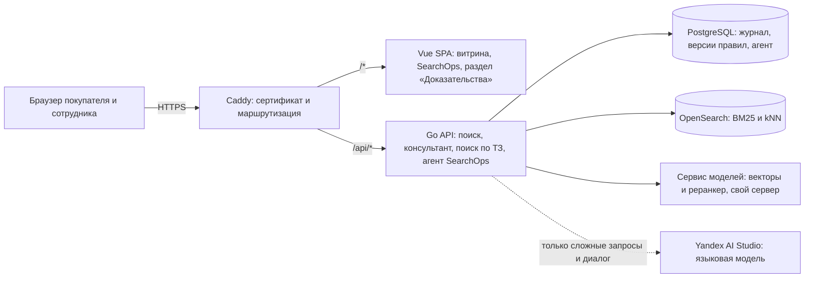
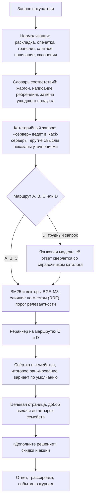

# PLEXeT SearchOps. Умный поиск для магазина «Софтлайн Решения»

Решение задачи «Умный поиск на сайте» хакатона «ИИкузница» (заказчик «Софтлайн Решения», трек «Аналитик данных»).
Состав решения: поиск по каталогу магазина, который сначала понимает запрос и потом ищет, блок сопутствующих товаров с
основанием у каждой рекомендации, ИИ-консультант, поиск по техническому заданию и фоновый агент SearchOps, который
разбирает неудачные поиски и готовит правки под утверждение человеком.

Стенд работает по адресу <https://softline.plexet.ru>. Витрина и раздел «Доказательства» открыты без входа. Вход в
бэк-офис выполняется демо-кнопками на странице `/login`.

Этот README содержит полное описание решения. Отчёт о решении с выводами формул, источниками и перечнем прогонов и
заполненный калькулятор экономики лежат в дополнительных материалах.

Центральное утверждение решения: **поиск приводит покупателя на нужную страницу первым же ответом, и это доказано на
запросах, которых он раньше не видел**. На десяти эталонных запросах заказчика первая ссылка ответа совпала с целевой
страницей в **10 случаях из 10**. Обычный текстовый поиск на том же каталоге справляется с 5 из 10.

Сто процентов на собственных наборах показывает любой настроенный поиск: наборы правят, пока промахов не останется. Мы
пошли дальше и проверили себя так, как проверяют чужую работу. До конца настройки были отложены 83 намеренно трудных
запроса, и никто из настраивавших поиск их не открывал. В наборе названия в чужой раскладке («fcnhf kbyerc» вместо
«астра линукс»), транслит, опечатки, словоформы из ТЗ, серверы, продукты без цены, вопросы покупателя и мусор. Прогон
был один, после заморозки поиска. Засчитывалось только точное совпадение первой ссылки с ожидаемой страницей. Поиск
попал в цель первым ответом в **66 запросах из 83**, текстовый поиск в 37. Там, где страницу товара нужно найти (69
запросов), счёт **54 против 23**. На 42 запросах с искажённым написанием нужная страница есть в первых четырёх ответах
**во всех 42 случаях**. Набор, разбор каждого запроса и все 17 промахов опубликованы:
[docs/CLOSED_SET_RUN.md](docs/CLOSED_SET_RUN.md). Это число нельзя подогнать, и поэтому ему можно верить.

Что стоит за этим результатом.

- Каталог настоящий: 136 040 предложений из фида магазина. Поиск работает на полном фиде, а не на выборке.
- Качество не куплено дорогой моделью. Языковая модель вызывается примерно в двух поисках из ста и в среднем стоит
  **0,0027 ₽** на поиск без НДС. На отложенном наборе она понадобилась в 12 запросах из 83. Без модели точность на
  журнале по фиду та же.
- Поиск чинит себя под присмотром человека. Агент SearchOps находит причину неудачного поиска и готовит правку. Правка
  попадает на витрину только через три замка: доказательство из поведения покупателя, прогон на 195 контрольных запросах
  без единой регрессии и решение человека.
- ИИ-консультант не выдумывает цены. Модель выбирает товар, а цены, артикулы и суммы подставляет программа из каталога:
  0 расхождений в 291 проверке цен и сумм.
- Каждое измеренное число на экране открывается: по нажатию появляется окно «Как посчитано».

Оговорки к каждому числу приведены в разделах «Результаты» и «Ограничения и допущения». Каждое число на фиде взято из
сохранённого прогона.

## Запуск

Стенд уже развёрнут, для оценки решения ничего ставить не нужно: <https://softline.plexet.ru>.

Свой стенд поднимается двумя командами (Docker, корневой `.env` по образцу `.env.example`):

```bash
docker compose -f deploy/docker-compose.yml --env-file .env build
docker compose -f deploy/docker-compose.yml --env-file .env up -d
# то же одной целью: make deploy; поднимаются PostgreSQL, OpenSearch, API, сервис моделей и Caddy с сертификатом
```

Полный порядок развёртывания из этого репозитория описан в отдельном документе [docs/DEPLOY.md](docs/DEPLOY.md): фид,
импорт каталога, демо-данные и проверка результата.

Локальная разработка. Нужны Docker, Go (тулчейн 1.27 докачается сам, `GOTOOLCHAIN=auto`), Node 22 с pnpm и Python 3.13
для `ml/` и конвертера фида. Фид заказчика в репозиторий не входит, выгрузку магазина нужно положить в
`data/softline/feed/Mindbox.yml.xml`. Всё остальное для фида лежит в репозитории: `data/softline/mapping.yaml`, словарь
соответствий, адреса семейств, документы совместимости, акции, классы допродажи, база знаний подбора и наборы оценки.

```bash
make env          # deploy/.env.dev и backend/.env из backend/.env.example; существующие не трогает
                  # в backend/.env вписать LLM_API_KEY и LLM_FOLDER_ID; без них языковая модель выключена
make db           # Postgres 127.0.0.1:5441 и OpenSearch 127.0.0.1:9201
make ml           # эмбеддер и реранкер на 127.0.0.1:8089, отдельный терминал (фоном: ml/run.sh start)

python3.13 scripts/data/softline_feed.py     # фид → data/softline/feed/*.jsonl и отчёт FEED_STATS.md
export DATA_SOURCE=generic DATA_MAPPING=../data/softline/mapping.yaml
make import                                  # фид → Postgres и OpenSearch, векторы по одному на семейство
(cd backend && go run . suggest-build)       # индекс подсказок по каталогу
make dev          # API 127.0.0.1:8088 и интерфейс http://localhost:5177; Ctrl+C гасит оба
```

Шаги от фида до импорта собраны в один скрипт: `scripts/setup-feed.sh <путь к фиду>`, после него остаётся `make dev`.
`DATA_MAPPING` указывается относительно `backend/`. Без `DATA_SOURCE` импорт и API работают на учебном каталоге
`data/mock/`. Интерфейс открывать по `localhost`, а не по `127.0.0.1`: изменяющие запросы принимаются только с адреса
из `PUBLIC_ORIGIN`.

Проверка кода одной командой: `make check` (линтеры, go vet и go test с `-race`, тесты фронта, сборка фронта, поиск
секретов).

Проверка заявленных чисел из каталога `backend/` (нужны `DATA_SOURCE`, `DATA_MAPPING`, `make db`, `make ml`;
остальные команды оценки перечислены в разделе «Воспроизводимость и проверка»):

```bash
go run . eval --set etalon,tz,neighbors,understanding --configs live     # полный продукт: 10/10, 7/7, 114/114, 64/64
go run . eval --set etalon,tz,neighbors,understanding --cold --configs BM25,B1,B2,live   # сравнение конфигураций
go run . guide-eval --runs 3 --report <файл>                             # режим подбора: 52 диалога по три прогона
```

## Архитектура и стек



| Часть | Что это | Зависимости |
|---|---|---|
| `backend/` | Go 1.27: конвейер поиска, режим подбора, поиск по ТЗ, агент SearchOps, оценка, учёт стоимости, HTTP API | Fiber v2, GORM и pgx, zap; PostgreSQL 19, OpenSearch 3 |
| `ml/` | Сервис моделей с TEI-совместимым HTTP: эмбеддер BGE-M3 и реранкер bge-reranker-v2-m3 | Python 3.13, модели работают на своём сервере, плата за вызов 0 ₽ |
| `frontend/` | Витрина, бэк-офис SearchOps и раздел «Доказательства» | Vue 3.5, TypeScript, Vite, reka-ui, Tailwind CSS 4, Pinia; шрифты и иконки лежат в репозитории, без CDN |
| `data/softline/` | Данные к фиду: `mapping.yaml`, словарь соответствий, адреса семейств, документы совместимости, акции, классы допродажи, база знаний, наборы оценки | CSV, JSONL, YAML |
| `deploy/` | Образы и compose стенда: `docker-compose.yml`, `Dockerfile.api`, `Dockerfile.ml`, `Dockerfile.web`, `Caddyfile` | Docker |
| `e2e/` | Сквозные тесты сценариев покупателя и сотрудника | Playwright |
| `scripts/` | Конвертер фида, сборщик адресов семейств, скрипты оценки через HTTP | Python 3.13 |

Языковая модель одна: Alice AI LLM Flash из Yandex AI Studio. Модель-судья qwen3.6-35b-a3b используется только при
оценке и на работу витрины денег не тратит. Векторы и реранкер считают свои модели на своём сервере, плата за
вызов у них нулевая. Контракт между частями один, HTTP API из `docs/openapi.yaml`. Поиск, ранжирование, метрики и
стоимость считает сервер, интерфейс только показывает. Поэтому экран и расчёт разойтись не могут. Лицензии зависимостей
перечислены в [LICENSES.md](LICENSES.md).

## Описание решения

Раздел самодостаточен и написан так, чтобы решение можно было понять и оценить, не открывая код.

### Постановка и главный вывод

Заказчик описал две проблемы. Техническая: поиск магазина сопоставляет запрос с текстом описаний, поэтому по слову
«сервер» отдаёт программы для сервера, а не оборудование. Коммерческая: поиск не помогает продавать, покупатель может
не узнать о сопутствующем товаре или о более полной редакции.

Данные заказчика: фид на 136 040 предложений (127 915 программ и 8 125 единиц оборудования), 1 232 вендора, 4 413
семейств и десять эталонных запросов с правильными целевыми страницами. В наличии с ценой 44 601 предложение, это 32,8
%. Остальные 67,2 % продаются только по запросу. Маржи, заказов, кликов и логов поиска в данных нет.

Главный вывод решения: на таком каталоге трудность лежит в выборе страницы, а не в подборе слов. У одного продукта
сотни лицензий, и любая из них подходит под слова запроса. Покупателю нужна одна ссылка, на общую страницу продукта.
Вывод получен измерением. Текстовый поиск с нормализацией и словарём даёт 7 эталонов из 10, а оставшиеся три добавляет
только выбор целевой страницы. Гибрид текста и векторов сам по себе точность на эталонах не поднял (6 из 10), зато дал
четыре разных семейства в каждом ответе. Мы не стали прятать это число. Вклад каждого шага измерен отдельно и по
нескольким метрикам, и в продукте остались только шаги, которые свой вклад доказали.

### Путь запроса

Порядок шагов задан в коде и одинаков для всех запросов. Каждый шаг пишет запись в трассировку: что сделал, сколько
это заняло, вызывалась ли модель. Трассировка открывается на витрине переключателем, и путь любого запроса виден
целиком.



Словарь соответствий хранится в файле данных и правится без повторной загрузки каталога. В нём 99 записей, у каждой
указаны тип связи и основание. Исходная версия правил содержит ещё 490 алиасов, из них 426 взяты из адресов страниц
вендоров на сайте магазина, где сохранились прежние имена. Замену ушедшего продукта поиск не подставляет молча:
карточки замены показываются с пояснением.

Маршрут выбирают правила. На A товар назван точно, на B поиск исправил слово или нашёл условия, на C описана задача
без названий, на D запрос трудный. Модель получает до 15 категорий и 20 вендоров из 551 и 1 232 и возвращает
типизированную структуру. Запрос к поисковому движку она не пишет. Код сверяет каждый идентификатор с полным
справочником и отбрасывает выдуманные. Отбор справочника сократил вход с 17 348 до 1 317 токенов, и разбор трудного
запроса подешевел с 1,44 до 0,12 ₽ без НДС. У шагов есть сроки: весь поиск не дольше 10 с, вектор запроса ждут 3 с,
вызов модели 8 с. Отказ внешнего сервиса поиск не останавливает: если сервис моделей или внешняя модель не ответили,
выдача строится по тексту и правилам.

Целевая страница выбирается по шести общим правилам, исключений под эталоны нет. Это страница семейства, вендора,
вендора с фильтром категории, категории или конкретного предложения. Вариант по умолчанию у карточки семейства:
базовая коммерческая лицензия, которую можно купить сейчас.

Ответ всегда набирает не меньше четырёх разных семейств: точные совпадения, другие лицензии того же продукта, похожие,
доступные альтернативы «Можно купить сейчас» и в последнюю очередь подписанный блок популярного. У каждой карточки
подписан тип совпадения, и покупатель видит, почему она в ответе. Жёсткие условия запроса на шагах добора не
ослабляются. Предложение без наличия или с нулевой ценой показывается с кнопкой «Запросить цену», цена из фида не
выдаётся за действующую.

### Допродажа без данных о заказах

Под ответом стоит блок «Дополните решение». Заказов в данных нет, и мы не стали изображать статистику совместных
покупок. Связи взяты из трёх проверяемых источников, и у каждой карточки записано основание рекомендации A, B, C.

| Основание | Источник | Объём |
|---|---|---|
| A | документ вендора о совместимости: сертификат, заключение, таблица поддерживаемых ОС | 41 запись, 39 с основанием A |
| B | сам каталог: техподдержка, продление и модули внутри семейства, позиции «для» платформы, экосистема вендора | хотя бы одна связь у 1 069 семейств из 1 809 с доступными предложениями |
| B | таблица классов продуктов по логике заказчика «купил офис, нужен антивирус» | 11 классов, 21 связь |
| C | та же задача, совместимость не подтверждена, подпись «проверьте совместимость» | 2 записи |

Связей, которые предложила только языковая модель, в блоке нет. Каждую рекомендацию можно проследить до документа
вендора или до строки каталога. Для оборудования есть справочник «С этим покупают» на 317 связей к программам с ценой
и в наличии. Те же дополнения выводятся в панели подсказок при вводе. Цен конкурентов в данных нет, поэтому более
выгодную цену поиск показывает тремя способами: скидка по старой цене фида (32 предложения), действующие акции магазина
(9 акций с подтверждённым сроком) и сравнение редакций одной линейки при одинаковых условиях.

### ИИ-консультант и поиск по ТЗ

ИИ-консультант ведёт режим подбора в окне переписки на витрине. Он задаёт уточняющий вопрос, сравнивает редакции по
базе знаний, подбирает лицензию под число мест и кладёт её в спецификацию. Принцип один: модель выбирает, программа
отвечает. Цены, названия, артикулы, ссылки и суммы подставляет программа из каталога, поэтому цена в ответе всегда из каталога. Если в тексте модели нашлось число со знаком рубля вне вставок или ссылка на несуществующую позицию, код
повторяет вызов один раз, а затем отдаёт запасной ответ со списком найденного. За ход бывает не больше двух вызовов
модели. Результат: полный подбор в **52 диалогах из 52** и ни одного выдуманного товара. База знаний содержит 182
факта о продуктах девяти вендоров эталонов и 13 правил лицензирования, у каждого факта есть источник и дословный
фрагмент.

Поиск по ТЗ принимает документ закупки в трёх форматах: DOCX, PDF с текстом и скан, до 20 МБ и до 50 позиций. Модель
выделяет позиции закупки с дословной цитатой требований, код проверяет, что цитата есть в документе, и по каждой
позиции идёт обычный поиск витрины. На тестовом документе все три формата дали одинаковые 8 позиций. Требования,
которые нельзя проверить по каталогу, выводятся строкой «Не проверено». Персональные данные перед отправкой в модель
маскируются.

### Агент SearchOps

Поиск со временем устаревает: в каталоге появляются продукты, покупатели приносят новые слова. Агент SearchOps держит
поиск в форме. Он умеет запускаться по расписанию, по всплеску неудачных поисков и по кнопке «Разобрать». На
демонстрационном стенде расписание выключено, запуски ручные. Агент собирает неудачные поиски в группы с общей
причиной и для каждой группы сам выбирает следующий шаг из набора инструментов: поиск как у покупателя, словарь,
каталог, цена и наличие, память прошлых решений. Если причина не в поиске, агент ставит задачу ответственному
сотруднику.

Правка агента попадает на витрину только через три замка.

1. Доказательство из поведения покупателя. Основание правки берётся из журнала: что ответил поиск и переформулировал
   ли покупатель запрос. Слова модели доказательством не считаются. Синоним, который модель
   предлагает на чужого производителя, программа отклоняет ещё до прогона.
2. Прогон на 195 контрольных запросах. Агент применяет правку на тестовой копии правил и прогоняет 17 эталонов и
   примеров из кейса и 178 запросов наборов соседей и понимания. Правка проходит только при нуле регрессий.
3. Решение человека. Правка ждёт в очереди, и утверждает её сотрудник с ролью-владельцем. Сам агент ничего не
   применяет.

Утверждённая правка становится новой версией правил, к прежней можно откатиться. После утверждения это обычная запись
словаря: она работает на каждом поиске и модели не требует.

Агент различает семь причин неудачи. У запуска есть пределы: 80 вызовов инструментов, 600 000 токенов, 40 ₽ и 25
минут. Пример полного цикла: агент заметил, что поиск не понимает «я360», предложил запись словаря «я360 → Яндекс 360
для бизнеса», проверил её на 195 запросах без единой регрессии, и человек утвердил правку. Разбор стоил 4,00 ₽ с НДС.
Теперь запрос «я360» на витрине ведёт на нужный продукт. Первый экран агента написан для маркетолога: спрос без
предложения, товар есть, но не найден, слова покупателей вне каталога, сервисные вопросы.

### Соответствие требованиям заказчика

Закрыты все 13 требований кейса и установочной встречи. Каждое прослеживается до механизма и до измерения.

| № | Требование | Как закрыто | Измерено |
|---|---|---|---|
| 1 | Понимать смысл: «сервер» означает оборудование | категорийный запрос, уточнения над выдачей | примеры из кейса: 7 из 7 |
| 2 | Жаргон: «антивирь», «офис», «винда» | словарь соответствий, 19 записей жаргона | набор понимания: 64 из 64 |
| 3 | Опечатки и транслит: «астра линукс», «мдаемон» | нормализация и 60 записей написания | соседи эталонов: 114 из 114 |
| 4 | Словарь с опорой на проверенные источники | у каждой записи тип связи и основание; 426 алиасов из адресов страниц вендоров | 99 записей словаря, 490 алиасов исходной версии |
| 5 | Рекомендации по каталогу и сайтам вендоров | блок «Дополните решение», основание рекомендации A, B, C | блок есть в 16 ответах из 17, 41 карточка |
| 6 | По «Astra Linux» показать сопутствующее, акцию и альтернативу | четыре карточки блока, бейдж «Скидка 26 %», строка акции; альтернатива «Можно купить сейчас» у продукта по запросу | экран выдачи на стенде |
| 7 | Более выгодная цена или акция | скидка фида, акции магазина, сравнение редакций за место | 32 предложения со скидкой, 9 акций |
| 8 | Подсказки с товарами при вводе | панель с третьей буквы: запросы, вендоры, товары | 7,8 мс по медиане, 48,8 мс p95 (65 запросов, локальный стенд) |
| 9 | Минимум четыре товара в ответе | добор выдачи до четырёх семейств | 131 ответ из 131 |
| 10 | Аналитика запросов, которая улучшает каталог | отчёт SearchOps, правки словаря и задачи каталогу | 536 поисков тестового трафика, ошибок 0 |
| 11 | Склонения: «астры линукс», «кибер бэкапа» | сравнение основ слов | 35 пар из 35 |
| 12 | Допродажа по классам продуктов | таблица классов и справочник «С этим покупают» | 11 классов, 21 связь, 317 связей для оборудования |
| 13 | Подсказки как канал допродажи | блок «Вам может быть интересно» в панели | экран витрины |

Сверх требований сделаны две вещи, которые заказчик на установочной встрече назвал гипотезой: консультант, который
сравнивает решения и отвечает на вопросы, и поиск по документу закупки. Обе работают на стенде. Таблица «требование,
код, тест, доказательство» лежит в [docs/REQUIREMENTS_MATRIX.md](docs/REQUIREMENTS_MATRIX.md).

### Результаты

Success@1 по целевой странице: первая ссылка ответа совпала с ожидаемой после нормализации адреса.

| Набор | BM25 | B1, текст с нормализацией и словарём | B2, гибрид | Полный продукт |
|---|---|---|---|---|
| Эталоны заказчика, 10 | 5 | 7 | 6 | **10** |
| Примеры из кейса, 7 | 2 | 1 | 3 | **7** |
| Соседи эталонов, 114 (набор настройки) | 46 | 71 | 67 | **114** |
| Понимание, 64 (набор настройки) | 31 | 46 | 50 | **64** |
| Ответов с четырьмя разными семействами, из 131 | 57 | 43 | 131 | **131** |

Полный продукт берёт максимум в каждой строке. Целевые страницы эталонов задал заказчик. Для семи примеров из кейса их
выбрала команда. Соседей и набор понимания команда видела при настройке, поэтому 100 % на них показывают, как поиск
отвечает на знакомые запросы. Как он отвечает на незнакомые, показывает отложенный набор ниже.

Ближе всего к живому трафику журнал поиска по фиду: 180 запросов журнала витрины, в 71 из них продукт искали по
точному названию. Конфигурации B0–B4 прогнаны на одном наборе с одной разметкой.

| Конфигурация | Hit@1 по семейству, 71 запрос | NDCG@10 по семействам | p50 / p95, мс |
|---|---|---|---|
| B0, подстрока в названии (наша реконструкция) | 25,4 % | 0,106 | 29 / 50 |
| B1, текст с нормализацией и словарём | 62,0 % | 0,476 | 9 / 19 |
| B2, гибрид | 70,4 % | 0,750 | 30 / 38 |
| B3, полный путь на правилах версии 1 | **85,9 %** | 0,771 | 129 / 562 |
| B4, с принятыми правками агента | **85,9 %** | 0,777 | 101 / 343 |

Каждая ступень лестницы прибавляет, и видно, какая сколько. Разбор намерения, атрибуты лицензии, порог и итоговое
ранжирование поднимают Hit@1 с 70,4 до 84,5 %, реранкер добавляет до 85,9 % (5 улучшений, 0 ухудшений). Без векторной
ветки Hit@1 падает до 74,6 %. Без языковой модели Hit@1 тот же, 85,9 %: правила и словарь справляются с большинством
запросов. Это свойство конструкции, а не случайность: модель нужна поиску на трудных запросах и нигде больше.

#### Отложенный набор: 83 запроса, которых поиск не видел

Все числа выше получены на запросах, которые команда видела. Главную проверку мы вынесли отдельно, и она отличает это
решение от поиска, который показывает только свои 100 %. До конца настройки были отложены 83 запроса с правильными
страницами. Их не открывали ни участники, настраивавшие поиск, ни агент SearchOps.

Набор намеренно труднее настоящего трафика. В него вошли виды запросов, на которых поиск по буквам ошибается чаще всего.
Они названы в кейсе и встречались нам раньше, когда мы разбирали около шестисот реальных и каверзных формулировок с
профильных форумов, из прайсов дистрибьюторов и от собственного тестирования. Половина набора (44 запроса) составлена
из искажённых названий по девяти вендорам из эталонов заказчика, вторая половина (39) покрывает остальной каталог. Ни
одна формулировка не совпадает с 232 запросами открытых наборов, со словами словаря и со строками тестов. Правильная
страница каждого запроса сверена с фидом, разметку до прогона подтвердили два участника команды.

Считали строго. Прогон один, после заморозки поиска, с выключенным кэшем. Ответ засчитан, только если первая ссылка
совпала с ожидаемой страницей. Нужный продукт на втором месте считается промахом. Нужный продукт первой карточкой, но
со ссылкой на конкретную модель вместо раздела, тоже считается промахом.

| Вид запроса | Примеры из набора | Запросов | Текстовый поиск | Полный продукт | В первых четырёх |
|---|---|---|---|---|---|
| Склонение | «астру линукс», «сканеру-вс» | 9 | 6 | **9** | 9 |
| Транслит | «эни деска», «икс спайдер» | 9 | 1 | **8** | 9 |
| Опечатка | «maxpatorl», «anydsek» | 9 | 2 | **9** | 9 |
| Чужая раскладка | «fcnhf kbyerc», «ьшскщыщае 365» | 8 | 0 | **6** | 8 |
| Название с условиями | «продление kes расширенный на 50 узлов» | 9 | 6 | **7** | 9 |
| Словоформа из ТЗ | «антивиря», «мдаемона» | 7 | 0 | **6** | 7 |
| Серверы | «двухпроцессорный сервер», «серверы supermicro» | 10 | 2 | **4** | 9 |
| Продукт без цены, рядом альтернатива | «windows 10 pro», «vmware vsphere» | 8 | 6 | **5** | 5 |
| Вопрос покупателя, а не товар | «как оплатить заказ» | 7 | 7 | **6** | 6 |
| Мусор | «zxcvbnm», «кукуруза в банке» | 7 | 7 | **6** | 6 |
| Всего | | 83 | 37 (45 %) | **66 (80 %)** | 77 (93 %) |

Что видно по таблице.

- Полный продукт привёл на ожидаемую страницу первым ответом в **66 запросах из 83**. Текстовый поиск в 37, со
  словарём и векторами в 46–47. Остальное дают определение категории, условия из запроса и выбор целевой страницы.
- Свои 37 попаданий текстовый поиск во многом набирает там, где можно не искать: 14 из них приходятся на вопросы и
  мусор, где правильный ответ состоит в том, чтобы не предлагать товар. Там, где страницу товара нужно найти (69
  запросов), у него 23 попадания, у полного продукта **54**.
- На 42 запросах с искажённым написанием (склонения, транслит, опечатки, раскладка, словоформы) текстовый поиск попадает
  первым ответом в 9. Полный продукт в 38, а в первых четырёх ответах нужная страница есть **во всех 42**.
- Чужая раскладка и словоформы из ТЗ текстовому поиску не даются совсем: 0 из 8 и 0 из 7. Полный продукт берёт 6 из 8 и
  6 из 7.
- Четыре разных семейства показаны во всех 83 ответах, у текстового поиска в 37.
- Языковая модель понадобилась на 12 запросах из 83. Медиана времени ответа 144 мс.

Промахов 17, и каждый разобран и опубликован. В пяти первая карточка правильная, но ссылка целевой страницы ведёт уже
или в сторону: например, на конкретный сервер вместо раздела серверов. В шести нужная страница стоит на втором–четвёртом
месте. Самый наглядный случай здесь «vnc kbyr». Это «мтс линк» в английской раскладке, но первые три буквы совпали с
названием настоящего продукта VNC, и он встал первым. В шести запросах покупатель не увидел нужного в первых четырёх
ответах: «windows 10 pro», «виндовс сервер стандарт», «autocad», «блок питания для сервера», «режим работы поддержки» и
«кукуруза в банке», на которую поиск нашёл программу «Коммерческий банк».

На наборах настройки у поиска 100 %, на отложенном 80 %. Разница между ними говорит не о слабости поиска, а о свойстве
проверки: на первых правила правились до нуля промахов, вторые поиск увидел впервые. Мы приводим оба числа, и второе
из них дороже первого. После прогона набор перестал быть отложенным, и 17 промахов уходят в наборы настройки как
готовый список правок для следующего круга.

Проверить: набор [data/softline/eval/closed.jsonl](data/softline/eval/closed.jsonl), отчёт прогона со всеми 83 запросами
[docs/CLOSED_SET_RUN.md](docs/CLOSED_SET_RUN.md), экран «Доказательства → Итог → На данных заказчика» на стенде, где
блок об отложенном наборе показан с таблицей по видам запросов.

#### Остальные измерения

Остальные измерения собраны в одной таблице.

| Показатель | Значение | Природа |
|---|---|---|
| Время ответа полного продукта на эталонах | 72 мс по медиане, 127 мс p95 | измерено, тёплый прогон, время сервера без сети |
| Режим подбора, полный подбор | **52 диалога из 52**, в трёх прогонах 156 из 156 | измерено, набор настройки |
| Обычный поиск на тех же задачах | 11 из 48 | измерено на первых 48 диалогах |
| Выдуманных товаров, неверных цен, нарушений правил лицензий | **0** | одиннадцать автопроверок каждого ответа, в том числе 0 расхождений из 291 проверки цен и сумм |
| Поиск по ТЗ, тестовый документ на 8 позиций | одинаковые 8 позиций в DOCX, PDF и скане, с ожидаемым ответом сходятся 6 | измерено |
| Блок «Дополните решение» на эталонах и примерах | 16 ответов из 17, у всех карточек причина, основание и цена | измерено |
| Запуски агента на каталоге заказчика | 21,02 ₽ с НДС за все запуски с вызовами модели | журнал вызовов модели |
| Модель на один поиск в среднем | **0,0027 ₽** без НДС | замер: модель разбирает 13,5 % поисков, 83,5 % разборов взято из кэша, вызов стоит 0,1222 ₽ |
| Стоимость поискового запроса | **около 57 копеек** при 15 000 запросов в месяц | расчёт: 96,2 % сервер, 3,3 % агент, 0,5 % модель; живое число на экране «Доказательства → Стоимость» |
| Ход ИИ-консультанта, разбор ТЗ на 8 позиций | 0,21 ₽ и 1,75 ₽ без НДС | журнал вызовов модели |

### Экономика эксплуатации

Поисковый запрос стоит около 57 копеек, и почти вся эта сумма приходится на аренду сервера. Языковая модель вызывается
примерно в двух поисках из ста и в среднем стоит **0,0027 ₽** на поиск. Качество не куплено дорогой моделью: на неё
приходится 0,5 % стоимости запроса.

Стоимость запроса считается по формуле `C = p × (1 − h) × c_llm + (I + A + S) / N`, где `p` доля поисков, которые
разбирает модель, `h` доля разборов из кэша, `c_llm` стоимость одного разбора, `I` инфраструктура в месяц, `A` агент в
месяц, `S` сопровождение, `N` запросов в месяц. У каждого параметра указано, замер это или допущение. Замеры: `p` =
13,5 % и `h` = 83,5 % по журналу витрины из 897 поисков, `c_llm` = 0,1222 ₽ без НДС по 16 вызовам, запуск агента 7,01 ₽
с НДС. Допущения: `N` = 15 000 (середина диапазона заказчика), сервер 8 218 ₽ в месяц по тарифу облака (4 vCPU, 16 ГБ),
40 запусков агента в месяц, сопровождение в расчёт не включено.

```
модель:      0,135 × (1 − 0,835) × 0,1222 = 0,0027 ₽
постоянная:  (8 218 + 280,4 + 0) / 15 000  = 0,5666 ₽
C = 0,0027 + 0,5666 ≈ 0,57 ₽ за запрос, 102 600 ₽ в год
```

Экран «Доказательства → Стоимость» считает то же самое по текущему журналу вызовов, поэтому число на нём живое и
держится около 57 копеек.

Векторы и реранкер считают свои модели на своём сервере, плата за вызов у них нулевая. Языковая модель на поиске
вызывается 0,0223 раза на запрос. Расход ограничен кодом, а не обещанием: дневной бюджет модели на весь сервис,
суточная квота разборов на адрес покупателя, пределы запуска агента. Режим без модели включается одной настройкой, и
качество на журнале по фиду при этом не падает.

Что поиск может вернуть магазину, посчитано по цифрам организаторов о доле неудачных поисков, уходах и конверсии. При
снижении доли неудач с 40 до 20 % и коэффициенте реализуемости 0,5 нижний сценарий даёт 180 возвращённых заказов в
год, средний 540, верхний 1 200. Средний чек и маржа магазина нам неизвестны, поэтому окупаемость мы не заявляем, а
отдаём формулу для подстановки в пилоте: [docs/EFFECT_MODEL.md](docs/EFFECT_MODEL.md).

### Веб-продукт

Три раздела по адресу стенда.

| Раздел | Кому | Что в нём |
|---|---|---|
| Поиск `/search` | покупатель, гость | панель подсказок при вводе, выдача с типами совпадения, «Дополните решение», трассировка, ИИ-консультант, загрузка ТЗ, спецификация и запрос коммерческого предложения |
| SearchOps `/searchops` | сотрудники по ролям | «Отчёт» для маркетолога, «Запросы без ответа», «Запуски» с лентой шагов агента, «Очередь» правок на утверждение, «Память», «Изменения» с версиями правил и откатом |
| Доказательства `/proofs` | все, гостю тоже | «На данных заказчика» с блоком об отложенном наборе, «Метрики», «Один запрос», «Контроль улучшений», «Вклад компонентов», «Стоимость», «Теоретические основы» |

Витрина. Наверху выдачи стоит строка «Мы поняли запрос так», и это понимание снимается одним нажатием. У карточки
подписаны тип совпадения и причина. Срок, количество и тип лицензии из текста запроса сужают варианты так же, как
фильтры. На «продлить касперский на 100 пк на 2 года» карточка берёт цену по ступени 100–149 узлов и сама считает итог
307 080 ₽, а над выдачей стоит строка сравнения редакций за узел. Для вошедшего демо-покупателя выдача учитывает его
историю: купленные лицензии стоят выше и помечены «Вы покупали».

Доказательства. Раздел открыт гостю, и проверить решение можно без входа и без кода. Измеренные числа в вёрстку не
вписаны: раздел пересчитывает их из таблицы прогонов и журнала вызовов модели при каждом открытии. Каждое посчитанное
сервером число на экране открывает окно «Как посчитано». Экран «Итог → На данных заказчика» собирает главное на одной
странице и содержит блок об отложенном наборе с таблицей по видам запросов. Вкладка «Контроль улучшений» показывает
сводку по парам конфигураций: сколько запросов стало лучше, сколько осталось без изменений и сколько стало хуже. 103
числовых параметра вкладки «Теоретические основы» сверяются с константами кода автотестом: поменяли порог в коде, тест
падает, пока не поправлен текст. Описание и код разойтись не могут.

У каждого экрана есть состояния загрузки, пустого результата и ошибки.

## Воспроизводимость и проверка

Числа раздела «Результаты» взяты из сохранённых прогонов, и каждый прогон можно повторить. Команды ниже запускаются из
`backend/` с переменными `DATA_SOURCE` и `DATA_MAPPING`, нужны `make db` и `make ml`.

| Команда | Что проверяет |
|---|---|
| `go run . eval --set etalon,tz,neighbors,understanding --configs live` | Success@1 по целевой странице у полного продукта |
| `go run . eval --set etalon,tz,neighbors,understanding --cold --configs BM25,B1,B2,live` | сравнение с упрощёнными конфигурациями, холодный прогон |
| `go run . eval --set closed --file <файл набора> --report <каталог>` | отложенный набор, один раз при заморозке |
| `go run . eval --summary <файл>` | сводка «На данных заказчика» по последним прогонам |
| `go run . guide-eval --runs 3 --report <файл>` | режим подбора: диалоги из `data/softline/eval/guide-dialogs.jsonl` и автопроверки |
| `go run . traffic --flow ../data/softline/searchops_flow.jsonl --duration 12m --panel 0` | тестовый трафик для агента настоящими поисками |
| `make sets`, затем `make eval SET=test CONFIGS=B0,B1,B2,B3,B4` | наборы и разметка из журнала в базе, метрики по семействам; нужен журнал поиска в базе |
| `API=http://127.0.0.1:8088 python3 scripts/eval/<скрипт>.py` | проверки через HTTP: `customer_eval.py`, `neighbor_eval.py`, `understanding_eval.py`, `declension_eval.py`, `suggest_prefix_eval.py`, `upsell_eval.py`, `p63_eval.py` |

Наборы для `go run . eval` и `guide-eval` лежат в `data/softline/eval/`. Часть Python-скриптов читает исходные наборы
из рабочей папки команды, которая в публичный репозиторий не входит.

Тесты кода запускаются целями `make test`, `make lint`, `make check` (всё вместе и поиск секретов), `make test-live`
(живой тест поиска на локальных OpenSearch и эмбеддере) и `make e2e` (сквозные тесты Playwright, нужны API на :8088 и
сервис моделей на :8089). В каталоге сервисов **471 тестовая функция**, у фронта **454 модульных теста**. При последнем
полном прогоне сквозных тестов прошёл **141**, упало 0, пропущено 38 по условиям окружения.

К каждой проверке предъявлено требование уметь падать. Проверка, которая не может упасть, ничего не доказывает.
Проверки режима подбора до показа сняли две фразы модели в варианте без них. Правила лицензий нашли 5 нарушений из 59
на первой карточке обычного поиска. Выдуманный моделью вендор «отечественный» отброшен сверкой со справочником и
превращён в фильтр «российское ПО». Скрипты оценки сравнивают каждый запрос «до» и «после» и считают сломанные отдельно:
во всех кругах правок их 0.

Требование относится и к самим метрикам. Первый подсчёт на фиде показал точный товар первым только у 13,7 % запросов.
Разбор промахов по одному показал, что ошибалась разметка: она не засчитывала правильный ответ, если первым стоял
другой артикул того же продукта. Мы перешли к счёту по семействам и поправили промпт судьи. Ошибку собственной метрики
мы нашли сами и описали здесь.

## Ограничения и допущения

Названы прямо, поскольку известные границы входят в результат. У каждого ограничения указано, в какую сторону оно
смещает оценку и почему вывод остаётся в силе.

| Что ограничено | Значение | Направление ошибки | Почему вывод остаётся в силе |
|---|---|---|---|
| Наборы настройки | 100 % на соседях, понимании, склонениях и диалогах подбора получены на запросах, которые команда видела | оптимистично | эталоны задал заказчик, а независимую проверку даёт отложенный набор: 66 из 83 |
| Отложенный набор | 83 запроса, намеренно труднее настоящего трафика; после прогона набор перестал быть отложенным | строго к нам | это свойство набора, а не слабость поиска: в него собраны виды запросов, на которых поиск по буквам ошибается чаще всего |
| Разметка журнала по фиду | клики на выдаче витрины и модель-судья; судья не дал высшую оценку 14,6 % целей на эталонах | клики подыгрывают B3 и B4 | рядом показаны эталоны с целевыми страницами заказчика и отложенный набор, где кликов в разметке нет |
| Поиск по подстроке B0 | наша реконструкция, действующий поиск магазина не замерялся | неизвестно | 25,4 % описывают метод, а не сайт заказчика; главное сравнение идёт с BM25 и B1 на том же каталоге |
| Целевые страницы примеров из кейса | выбраны командой | возможно в нашу пользу | результат 7 из 7 показан отдельно от эталонов |
| Маржа и популярность | в данных их нет: маржа 0, популярность 0,5 у всех | нейтрально | слагаемые не меняют порядок; формула оставлена целиком и примет данные магазина без переделки |
| Заказы и совместные покупки | в данных их нет | польза для продаж не измерена | блок назван «Дополните решение», у связи подписано основание; пользу для продаж нужно мерить в пилоте |
| Логи поиска магазина | нет, агент работает на тестовом трафике с модельными частотами | частоты условны | отчёт так и подписан; механизм агента от источника журнала не зависит |
| Запуски агента на стенде | расписание выключено, запуски ручные | на качество не влияет | расписание и запуск по всплеску включаются настройками `AGENT_SCHEDULE` и `AGENT_SPIKE` |
| Вектор | один на семейство | векторы не различают лицензии | лицензии внутри семейства различают правила и текстовый поиск |
| Адреса семейств | собраны с сайта, 1 808 из 1 809 | устаревают при смене адресов | сборщик запускается заново одной командой: `scripts/data/softline_family_urls.py collect` |
| База знаний подбора | 172 факта проверены агентом, человеком пока ни один | возможны ошибки в фактах | строки показаны с источником и дословным фрагментом; черновики не показываются |
| Доля разборов моделью и доля кэша | 13,5 % и 83,5 % по журналу витрины с повторами | доля кэша завышена | без кэша модель стоит 0,0165 ₽ на поиск, и главная статья остаётся прежней |
| Сервер | 8 218 ₽ в месяц по тарифу, не по счёту | нагрузку мерили только локально | масштабируемость кейс назвал необязательной; формула примет фактический счёт |
| Маскирование персональных данных | телефон, почта, ИНН, КПП, ОГРН, номер карты, СНИЛС, паспорт; имена и адреса не распознаются | имя или адрес могут уйти в модель | строка запроса в журнал не пишется |
| Сравнение цен | только подобное с подобным, без слов «лучше» и «самый выгодный» | осторожно | это наше прочтение закона «О рекламе», а не юридическое заключение |

## Самооценка по критериям

Оценка команды по критериям жюри: шесть критериев, от 0 до 3 баллов каждый. Мы ставим себе максимум по каждому и ниже
показываем, на чём он держится.

| Критерий | Максимум | Самооценка | Обоснование |
|---|---|---|---|
| Соответствие задаче партнёра | 3 | **3** | закрыты все 13 требований кейса и установочной встречи, каждое прослеживается до механизма и измерения; эталоны заказчика 10 из 10, четыре товара в 131 ответе из 131; сверх требований сделаны консультант и поиск по ТЗ |
| Корректность технической реализации | 3 | **3** | гибридный поиск со слиянием по местам, модель возвращает структуру под проверкой кода, вклад каждого шага измерен на конфигурациях B0–B4, на отложенном наборе из 83 незнакомых запросов 66 попаданий против 37 у текстового поиска |
| Потенциал внедрения | 3 | **3** | независимый HTTP API, каталог подключается файлом соответствия полей, версии правил с откатом, работа без модели одной настройкой, план пилота |
| Степень готовности | 3 | **3** | работающий стенд на полном фиде заказчика: витрина, консультант, поиск по ТЗ, бэк-офис по ролям, доказательства; сквозные тесты: 141 прошёл, падений нет |
| Агентность | 3 | **3** | автономный многошаговый агент с инструментами, пересмотром гипотез, памятью, запуском по расписанию и по всплеску, проверкой правки прогоном на 195 запросах и очередью на утверждение |
| Экономика эксплуатации | 3 | **3** | формула стоимости с пометкой «замер» или «допущение» у каждого параметра: около 57 копеек за запрос, из них модель 0,0027 ₽; расход ограничен бюджетами в коде |

Итого: **18 из 18**.

### Обоснование оценок по пунктам

Для каждого критерия ниже приведены три вещи: что требует формулировка критерия, на что опирается наша оценка и где
это проверить на стенде или в репозитории.

#### Соответствие задаче партнёра (3 из 3)

Требование критерия. Полное соответствие задаче, учтены нефункциональные требования.

Основание оценки. Каждое из 13 требований кейса и установочной встречи прослеживается до механизма и измерения,
таблица приведена в разделе «Соответствие требованиям заказчика». На десяти эталонах заказчика первая ссылка ведёт на
заданную им страницу во всех десяти случаях. Требование четырёх товаров выполнено в 131 ответе из 131 и не ослаблено
ни для одного запроса, включая бессмыслицу. Пример из кейса с Astra Linux воспроизведён целиком: сопутствующее с
документами вендоров, скидка, акция, а альтернатива появляется у продукта, который продаётся только по запросу.
Склонения, названные заказчиком на встрече, проходят в 35 парах из 35. Нефункциональная часть закрыта так же полно:
посчитана стоимость запроса, каждый шаг виден в трассировке, секреты не покидают сервер, поиск работает на полном фиде
в 136 040 предложений. Гипотезу заказчика о поиске-консультанте мы довели до работающего продукта.

Где проверить. Стенд, запросы «сервер», «астры линукс», «windows server», «продлить касперский на 100 пк на 2 года»;
экран «Доказательства → На данных заказчика»; [docs/REQUIREMENTS_MATRIX.md](docs/REQUIREMENTS_MATRIX.md).

#### Корректность технической реализации (3 из 3)

Требование критерия. Реализация соответствует лучшим практикам.

Основание оценки. Поиск построен как конвейер с измеренным вкладом каждого шага. Текстовый поиск BM25 и векторы BGE-M3
сливаются по местам, порог релевантности не даёт векторам подставить ближайший товар вместо честного «такого нет»,
реранкер включён только там, где он полезен. Языковая модель не пишет запрос к движку: она возвращает типизированную
структуру, и код сверяет её со справочником. Конфигурации B0–B4 прогнаны на одном наборе, Hit@1 по семейству растёт от
25,4 до 85,9 %, и по таблице вклада видно, что именно дал каждый шаг. Правки принимались только при нуле сломанных
запросов. Главное основание оценки состоит в том, как решение проверяет само себя. 83 трудных запроса были отложены до
конца настройки и прогнаны один раз: 66 из 83 против 37 у текстового поиска, все 17 промахов разобраны и опубликованы.
Источник разметки подписан у каждого числа, а ошибка собственной метрики найдена и описана. Код покрыт 471 тестовой
функцией сервера и 454 тестами фронта, линтеры и поиск секретов входят в одну команду.

Где проверить. `make check`; `go run . eval --set etalon,tz,neighbors,understanding --cold --configs BM25,B1,B2,live`;
вкладки «Вклад компонентов» и «Контроль улучшений» в разделе «Доказательства»; переключатель «Трассировка» на витрине;
[docs/CLOSED_SET_RUN.md](docs/CLOSED_SET_RUN.md), [docs/ARCHITECTURE.md](docs/ARCHITECTURE.md) и
[docs/EVALUATION.md](docs/EVALUATION.md).

#### Потенциал внедрения (3 из 3)

Требование критерия. Решение готово к пилоту без существенной доработки.

Основание оценки. Поиск уже работает на полном фиде магазина, а не на выборке. Движок не привязан к CMS: витрина
магазина обращается к нему по HTTP API, корзина, карточка и счёт остаются у магазина. Каталог подключается файлом
соответствия полей `data/softline/mapping.yaml` без правки кода, импорт строит новый индекс и переключает его
атомарно. Словарь, акции, документы совместимости и база знаний лежат в файлах данных и обновляются без повторной
загрузки каталога. Каждая утверждённая правка даёт новую версию правил, к прежней можно откатиться. Провайдер модели
задаётся настройками, поиск работает и без модели. При отказе сервиса моделей выдача строится по тексту. Формула
итогового ранжирования уже содержит слагаемые маржи, популярности и контекста клиента: когда магазин даст эти данные,
они подставятся без переделки. Граница с Mindbox и спецификатором магазина описана отдельно. План пилота написан.

Где проверить. [docs/INTEGRATION.md](docs/INTEGRATION.md), [docs/PILOT.md](docs/PILOT.md),
[docs/MINDBOX_BOUNDARY.md](docs/MINDBOX_BOUNDARY.md), [docs/openapi.yaml](docs/openapi.yaml); вкладка «Изменения» в
SearchOps с версиями и откатом; `deploy/docker-compose.yml`.

#### Степень готовности (3 из 3)

Требование критерия. Полнофункциональный работающий продукт.

Основание оценки. На стенде работает весь путь покупателя и сотрудника. Покупатель получает подсказки при вводе,
выдачу, страницу товара, спецификацию и запрос коммерческого предложения, может поговорить с ИИ-консультантом и
загрузить ТЗ. Сотрудник входит под своей ролью, читает отчёт, запускает агента, утверждает или отклоняет правку и
откатывает версию. Поиск выдерживает произвольный ввод: на бессмыслицу он отвечает сообщением и подписанным блоком
популярного. Сквозные тесты проходят сценарии обеих ролей на трёх ширинах экрана: 141 прошёл, 0 упало. Режим подбора
решил 52 диалога из 52 без единого выдуманного товара и неверной цены. Тестовый трафик из 536 поисков прошёл без
ошибок. Это продукт, которым можно пользоваться сейчас, а не макет.

Где проверить. <https://softline.plexet.ru>: любой свой запрос на витрине, кнопка консультанта в правом нижнем углу,
скрепка в строке поиска для ТЗ, вход демо-кнопкой на `/login`; `make e2e`.

#### Агентность (3 из 3)

Требование критерия. Автономный многошаговый агент или промышленная инфраструктура: память, оркестрация.

Основание оценки. SearchOps выбирает следующий шаг сам, пока не решит задачу или не исчерпает бюджет. Он умеет
запускаться без человека: по расписанию, по всплеску неудачных поисков, по изменению каталога. На демонстрационном
стенде расписание выключено, запуски ручные, кнопкой «Разобрать». У агента есть инструменты (поиск как у покупателя,
словарь, каталог, цена и наличие), до трёх гипотез на группу и память прошлых решений: повторный запуск пропустил уже
разобранные группы и стоил 0 ₽. Правку агент проверяет сам на тестовой копии правил, и код не пропускает её при любой
регрессии на 195 запросах. Слова модели доказательством не считаются: синоним на чужого производителя код отклоняет до
прогона. Оркестрация промышленная: пул запусков, пределы по шагам, токенам, рублям и времени, очередь на утверждение по
ролям, версии и откат. Агент работает на несколько ролей, как просил заказчик: маркетолог получает отчёт о спросе,
каталог получает задачи, администратор поиска получает готовые правки. Сам агент ничего не применяет, и это
сознательное решение: поиск чинится под присмотром человека. После утверждения правка становится обычной записью
словаря и работает без модели. Маршруты A–D мы агентом не называем, это маршрутизация правилами.

Где проверить. Раздел SearchOps на стенде: «Отчёт», «Запуски» с лентой шагов, «Очередь», «Память», «Изменения»; запрос
«я360» на витрине как результат утверждённой правки.

#### Экономика эксплуатации (3 из 3)

Требование критерия. Экономика обоснована для промышленной эксплуатации.

Основание оценки. Стоимость запроса посчитана по формуле, у каждого параметра указано, замер это или допущение. При 15
000 запросов в месяц запрос стоит около 57 копеек, из них 96,2 % приходится на сервер и 0,5 % на модель. Модель на
поиске стоит в среднем 0,0027 ₽ без НДС, потому что вызывается только на маршруте D, а 83,5 % разборов берутся из кэша.
Отбор справочника для модели удешевил один разбор с 1,44 до 0,12 ₽. Векторы и реранкер работают на своих моделях без
платы за вызов. Отдельно посчитаны ход консультанта (0,21 ₽), разбор ТЗ (1,75 ₽ на восемь позиций) и запуск агента
(7,01 ₽ с НДС). Расход ограничен кодом, а не обещанием. Чувствительность показана: без кэша модель стоит 0,0165 ₽ на
поиск, и вывод не меняется. Шаблон калькулятора организаторов заполнен по журналу вызовов и лежит в дополнительных
материалах.

Где проверить. Экран «Доказательства → Стоимость» с живым числом и разбивкой по маршрутам A–D; раздел «Экономика
эксплуатации» выше; [docs/COSTS.md](docs/COSTS.md).

### Безопасность

Безопасность упомянута в анонсе хакатона, поэтому отвечаем на неё отдельно.

Секреты задаются только переменными окружения на сервере. Во фронтенд ключи не попадают, все вызовы модели идут с
сервера, `make check` ищет секреты в истории репозитория и в собранном бандле.

Вход выполняется по ролям: гость, покупатель и четыре роли сотрудников. Сессия хранится в подписанной HttpOnly cookie.
Новый маршрут API закрыт по умолчанию, гость получает 401, покупатель 403, решение по правке принимает только
роль-владелец. Изменяющие запросы принимаются только с адреса стенда.

Модель не пишет запросы к движку и не подставляет цены. Её ответ проходит сверку со справочником каталога, а в режиме
подбора ещё и проверки до показа. Перед каждым вызовом внешней модели маскируются телефон, почта, ИНН, КПП, ОГРН,
номер карты, СНИЛС и паспорт. Строка запроса в журнал сервера не пишется. Что именно уходит во внешнюю модель, описано
в [docs/DATA_FLOW.md](docs/DATA_FLOW.md).

Лимиты и бюджет заданы в коде: число запросов в минуту с одного адреса, суточная квота разборов моделью на адрес
покупателя, дневной бюджет модели на весь сервис и пределы одного запуска агента. При исчерпании бюджета поиск
продолжает работать на правилах и кэше.

## Справочные сведения

### Переменные окружения

Полный список с комментариями: `backend/.env.example` (API) и `.env.example` (compose стенда). Ниже только имена.

| Группа | Переменные |
|---|---|
| Сервер | `APP_ENV`, `PORT`, `DATABASE_URL`, `PUBLIC_ORIGIN`, `TRUSTED_PROXIES` |
| Данные | `DATA_SOURCE`, `DATA_MAPPING`, `DATA_DIR`, `INDEX_ALIAS` |
| Поиск и модели | `OPENSEARCH_URL`, `EMBEDDER_URL`, `RERANKER_URL`, `SEARCH_RERANK_WEIGHT`, `SEARCH_MODEL_CACHE_SIZE`, `SEARCH_MODEL_CACHE_TTL`, `SEARCH_FALLBACK_BLOCK`, `UPSELL_BLOCK_TITLE`, `UPSELL_SAME_VENDOR_MAX_RATIO` |
| Языковая модель | `LLM_PROVIDER`, `LLM_BASE_URL`, `LLM_MODEL`, `LLM_FOLDER_ID`, `LLM_API_KEY`, `LLM_MODE`, `LLM_INTENT_MODEL`, `LLM_FALLBACK_MODEL`, `LLM_JUDGE_MODEL`, `LLM_DAILY_BUDGET_RUB`, `LLM_PER_IP_DAILY_RUB`, `RATE_LIMIT_PER_MIN` |
| Консультант и ТЗ | `CONSULTANT_REPLY_MODEL`, `CONSULTANT_LINK_PAYMENT`, `CONSULTANT_LINK_DELIVERY`, `CONSULTANT_LINK_CONTACTS`, `GUIDE_MIN_FACT_STATUS`, `OCR_URL`, `OCR_API_KEY`, `OCR_FOLDER_ID` |
| Агент SearchOps | `AGENT_MODEL`, `AGENT_SCHEDULE`, `AGENT_SCHEDULE_INTERVAL`, `AGENT_SCHEDULE_AT`, `AGENT_SCHEDULE_DAYS`, `AGENT_SPIKE`, `AGENT_SPIKE_WINDOW`, `AGENT_SPIKE_MIN_SEARCHES`, `AGENT_SPIKE_EMPTY_SHARE`, `AGENT_SPIKE_REFORM_SHARE`, `AGENT_SPIKE_QUERY_FREQ`, `AGENT_SPIKE_COOLDOWN`, `AGENT_CATALOG_TRIGGER`, `AGENT_TRIGGER_CHECK`, `AGENT_READ_ONLY`, `AGENT_MAX_PARALLEL`, `AGENT_RUN_MAX_STEPS`, `AGENT_RUN_MAX_TOKENS`, `AGENT_RUN_MAX_RUB`, `AGENT_RUN_MAX_DURATION`, `AGENT_QUERY_MAX_DURATION`, `AGENT_MAX_REGRESSION_WORSE`, `AGENT_REGRESSION_SETS`, `AGENT_FEED_REGRESSION_SETS`, `AGENT_BUDGET_RESERVE_RUB` |
| Доступ | `ADMIN_ENABLED`, `BACKOFFICE_TOKEN`, `AUTH_REQUIRED`, `DEMO_LOGIN_BUTTONS`, `AUTH_ACCOUNTS`, `AUTH_SESSION_TTL`, `AUTH_LOGIN_PER_MIN` |
| Флаги модулей | `FEATURE_HARDWARE`, `FEATURE_COMPANIONS`, `FEATURE_MARGIN_POLICY`, `FEATURE_SOLUTIONS`, `FEATURE_PANEL`, `FEATURE_PANEL_PRODUCTS`, `FEATURE_PANEL_MARGIN`, `FEATURE_PANEL_RECS`, `FEATURE_PANEL_VIEWED`, `FEATURE_RESULTS_V3` |
| Сервис моделей (`ml/run.sh`) | `ML_HOST`, `ML_PORT` |
| Только compose стенда | `DOMAIN`, `ACME_EMAIL`, `POSTGRES_DB`, `POSTGRES_USER`, `POSTGRES_PASSWORD`, `BACKOFFICE_USER`, `BACKOFFICE_HASH`, `TRAFFIC_RATE`, `TRAFFIC_MAX_RPM`, `TRAFFIC_SPIKES`, `TRAFFIC_SPIKE_LEN`, `TRAFFIC_SPIKE_SESSIONS`, `TRAFFIC_REPEAT` |

### API

Полное описание лежит в [docs/openapi.yaml](docs/openapi.yaml). Витрина, без входа: `POST /api/search`, `GET
/api/suggest`, `GET /api/products/{id}`, `POST /api/guide/route`, `POST /api/guide`, `POST /api/guide/spec`, `POST
/api/consultant`, `POST /api/tz`, `POST /api/quotes`, `POST /api/events`, `GET /api/evaluations/feed`, `GET
/api/costs/summary`. Бэк-офис: `GET /api/agent/report`, `POST /api/agent/runs`, `GET /api/proposals`, `POST
/api/proposals/{id}/approve` и `/reject`, `GET /api/guide/gaps`, `GET /api/costs`, `POST /api/configs/rollback` и
другие. Ошибки приходят в виде `{"error":{"code","message","traceId"}}`.

### Документы

| Документ | О чём |
|---|---|
| [docs/DEPLOY.md](docs/DEPLOY.md) | полный порядок развёртывания: фид, импорт, демо-данные, проверка |
| [docs/CLOSED_SET_RUN.md](docs/CLOSED_SET_RUN.md) | отложенный набор: все 83 запроса, ответы и разбор 17 промахов |
| [docs/REQUIREMENTS_MATRIX.md](docs/REQUIREMENTS_MATRIX.md) | требования кейса и установочной встречи: код, тест, доказательство |
| [docs/EVALUATION.md](docs/EVALUATION.md) | методика оценки, наборы, прогоны |
| [docs/ARCHITECTURE.md](docs/ARCHITECTURE.md) | устройство поиска и агента, модель угроз |
| [docs/COSTS.md](docs/COSTS.md), [docs/EFFECT_MODEL.md](docs/EFFECT_MODEL.md) | стоимость эксплуатации и модель эффекта |
| [docs/INTEGRATION.md](docs/INTEGRATION.md), [docs/PILOT.md](docs/PILOT.md), [docs/MINDBOX_BOUNDARY.md](docs/MINDBOX_BOUNDARY.md) | подключение к сайту, план пилота, граница с системами магазина |
| [docs/DATA_FLOW.md](docs/DATA_FLOW.md) | что уходит во внешнюю модель |
| [data/softline/FEED_STATS.md](data/softline/FEED_STATS.md), [data/softline/FAMILY_URLS.md](data/softline/FAMILY_URLS.md), [data/softline/kb/README.md](data/softline/kb/README.md) | сверка фида, покрытие адресов семейств, база знаний подбора |
