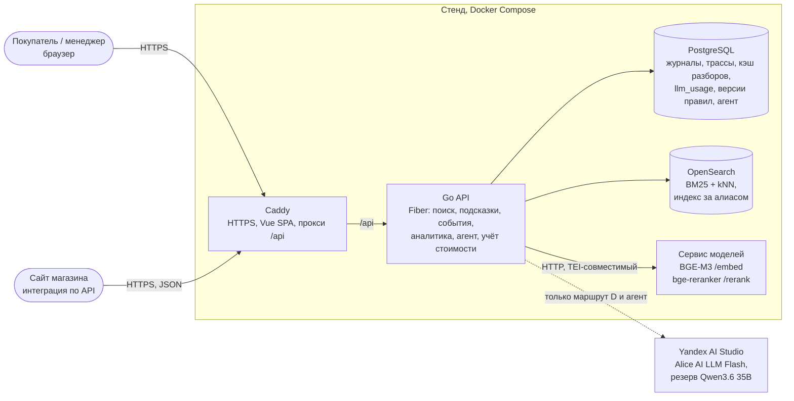
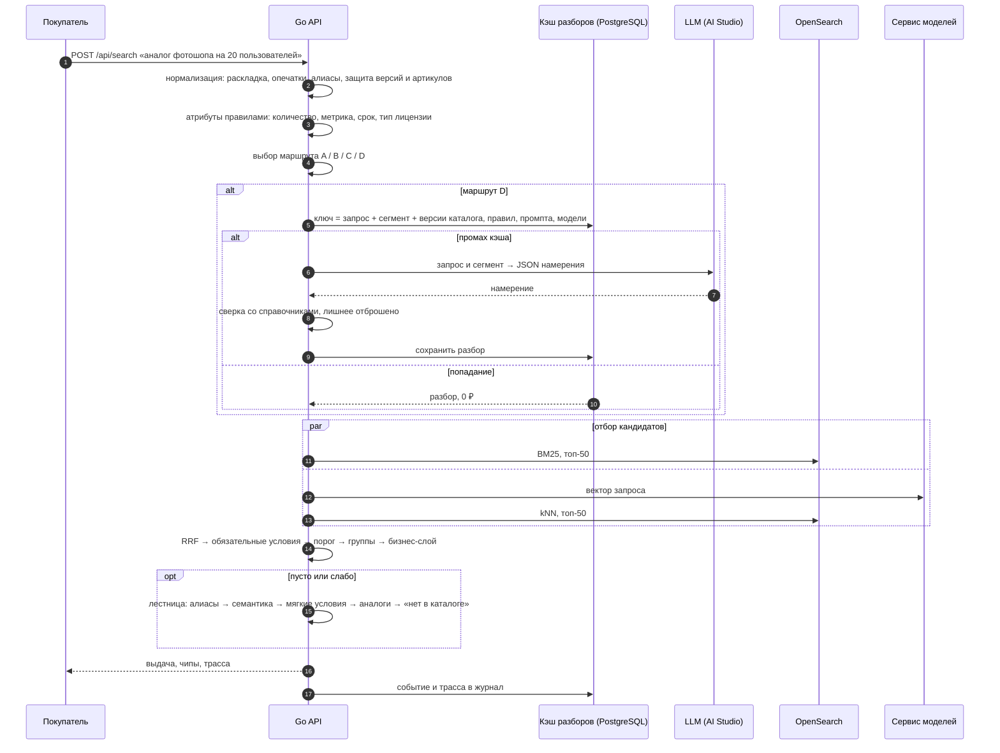
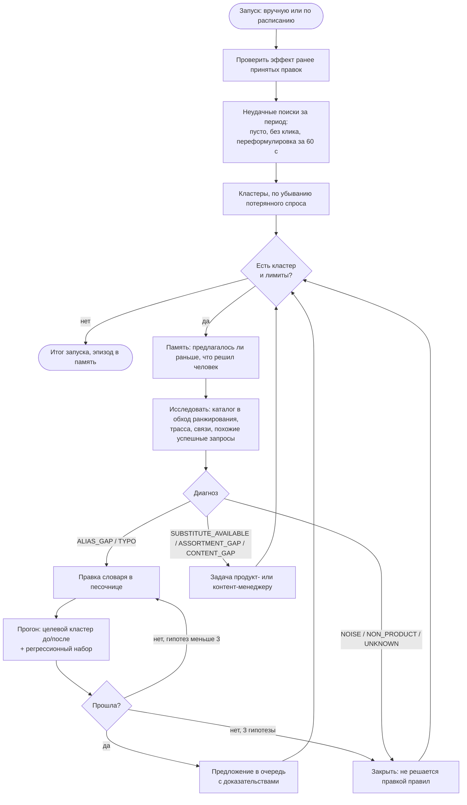
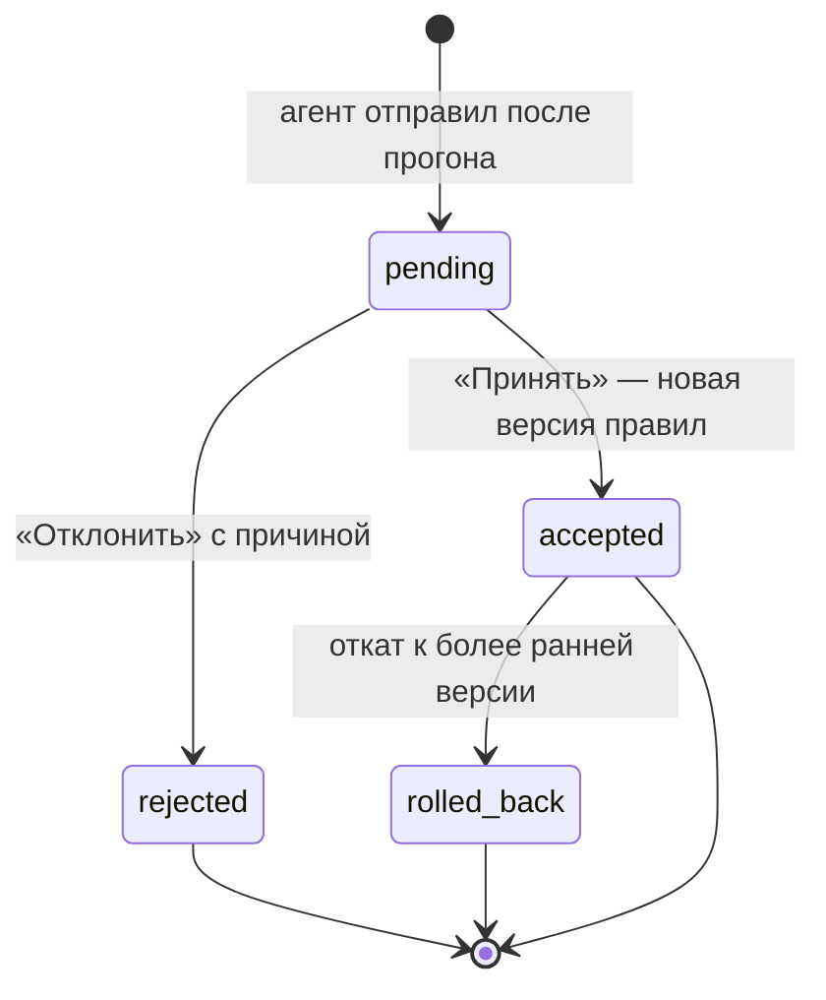

# Архитектура PLEXeT SearchOps

Две части. **Поиск** отвечает покупателю за десятки миллисекунд и объясняет каждую позицию выдачи.
**Агент SearchOps** работает в фоне: разбирает неудачные поиски, проверяет правку прогоном и отдаёт её
человеку. Сам агент ничего не меняет.

Все цифры ниже измерены на собственных mock-данных (228 позиций ПО, 381 размеченный запрос, 30 дней логов),
см. [EVALUATION.md](EVALUATION.md). Данные организаторов выдаются после 26.11.

## 1. Контейнеры

| Часть | Что делает |
| --- | --- |
| Go API | Весь бэкенд: поиск, подсказки, события, аналитика, оценка, агент, учёт вызовов LLM. Один процесс |
| OpenSearch 3.9 | Полнотекстовый индекс и векторы каталога. Импорт строит новый индекс `products_v{N+1}` и атомарно переключает алиас; поиск во время импорта идёт по старому |
| Сервис моделей | BAAI/bge-m3 (эмбеддинги) и BAAI/bge-reranker-v2-m3. HTTP-интерфейс как у Text Embeddings Inference: локально — нативный сервис, на стенде — контейнер |
| PostgreSQL 19 | События, трассы, кэш разборов, учёт вызовов LLM, версии правил, запуски и шаги агента, предложения, прогоны оценки |
| Yandex AI Studio | Внешняя LLM. Вызывается только на маршруте D (при промахе кэша) и агентом |

Что выключается и как это видно:

| Нет сервиса | Поведение |
| --- | --- |
| LLM (`LLM_MODE=off` или нет ключа) | Поиск отвечает на всё: маршрут D работает на кэше разборов и правилах. В трассе — причина |
| Сервис моделей | Шаг `dense` пропущен, в трассе `skipped: true` и причина |
| OpenSearch | `/api/search` отвечает 503, `/health` — `search: down` |
| PostgreSQL | Поиск работает, но не пишет журнал |

## 2. Путь запроса

### Шаги

1. **Нормализация** без LLM. Нижний регистр, раскладка (в том числе всей фразой), смешанные алфавиты,
   опечатки по словарю токенов каталога, алиасы («винда» → Windows). Версии и артикулы («2021», «8.3», «365»)
   защищены от исправлений. Исправление с высокой уверенностью применяется, и его можно отменить.
2. **Атрибуты правилами**: «на 10 пк» → 10 устройств, «на 5 пользователей», «на год», «бессрочно»,
   «продление», «отечественный». Неясная метрика превращается в уточняющий вопрос, а не в догадку.
3. **Маршрут** — по сигналам в запросе:

   | Маршрут | Когда | Что работает |
   | --- | --- | --- |
   | A. Точный | Артикул или точное название семейства, вендора | Текстовый и векторный поиск |
   | B. Нормализованный | Сработали раскладка, опечатка, алиас или найдены атрибуты | Правила и словари |
   | C. Семантический | Сущностей каталога нет | Векторы |
   | D. Сложный | Незнакомые слова; «аналог», «замена», «вместо»; больше 5 значимых слов; нетоварный запрос; конфликт атрибутов | Кэш, затем LLM |

4. **Разбор намерения (только D)**. LLM возвращает JSON по схеме: тип намерения, продукт-референс,
   категория, вендор, обязательные и мягкие условия. Код сверяет каждое значение со справочниками и
   отбрасывает несуществующее; правила приоритетнее модели. Ошибка схемы — один повтор, затем откат на
   правила. Запрос к движку строит код, а не модель.
5. **Отбор кандидатов**: BM25 топ-50 и kNN топ-50, слияние RRF в коде Go (k = 20 для B3).
6. **Ранжирование** по порядку: обязательные условия (нарушение — исключение с причиной в трассе) →
   порог релевантности (0,30 от лучшего) → группы «точное / подходящее / аналог» → бизнес-слой внутри группы:
   `final = 0,80·relevance + 0,10·popularity + 0,05·margin + 0,05·context`. Бизнес-слой не поднимает товар из
   нижней группы в верхнюю. Веса не обучены: это стартовая конфигурация.
7. **Лестница пустой выдачи**: подтверждённые алиасы → семантика → ослабление мягких условий (покупателю
   пишется, что ослаблено) → аналоги из справочника с пометкой → честное «нет в каталоге» и кнопка
   менеджера. Обязательные условия молча не ослабляются.
8. **Ответ**: выдача, чипы «как мы поняли запрос», связанные запросы, блок «С этим покупают», трасса.

Пороги подобраны на настроечном наборе: порог релевантности 0,30; кандидат только из векторов — скор kNN
не ниже 0,745; аналог отсутствующего товара — не ниже 0,76; RRF k = 20.

Реранкер подключён в сервисе моделей, но в выдаче выключен: на настроечном наборе он добавлял 136 мс на 21
текст и почти не различал позиции. В трассе шаг `rerank` есть со `skipped: true`.

### Трасса

Каждый ответ несёт трассу и сохраняется в `search_traces`: шаги с временем, маршрут, источник разбора
(`rules`, `cache`, `llm`), разложение итогового скора по слагаемым, отсечённые товары с причиной
(`license_metric_mismatch`, `below_threshold`, `vendor_mismatch` и др.), стоимость запроса. Пропущенный шаг
остаётся с `skipped: true` — по трассе видно, что модель не вызывалась. Трассу показывает экран «Поиск»,
по ней же строятся аналитика, учёт стоимости и вход агента.

### Контекст клиента

Сегмент и история покупок входят в бизнес-слой (слагаемое `context`). Явно написанное в запросе важнее
истории. Пример: «продлить антивирус» у клиента с купленным KSOS на 10 ПК — первым его продление, у клиента
без истории — общая выдача. Персонализированные разборы в общий кэш не смешиваются: сегмент входит в ключ.

## 3. Агент SearchOps

Цикл вызова инструментов на Go. Модель (Alice AI LLM Flash, нативные `tool_calls`) выбирает инструмент,
код проверяет аргументы по типизированной схеме, выполняет и пишет шаг в `agent_steps`. Ход запуска
транслируется в интерфейс по SSE. Python-фреймворки и несколько агентов не используются.

**Инструменты (15)**, все детерминированы, у агента нет SQL, shell и записи в боевой индекс:
`get_failed_queries`, `get_query_cluster`, `search_catalog`, `get_active_rules`, `get_search_trace`,
`find_similar_successful_queries`, `get_product_details`, `get_product_relations`, `get_previous_decisions`,
`create_sandbox_patch`, `run_evaluation`, `submit_proposal`, `create_assortment_ticket`, `close_cluster`,
`verify_applied_change`.

**Песочница.** Правка живёт как снимок правил и прогоняется через тот же сервис поиска, что и боевой
запрос, без записи в журнал. Допуск: целевой кластер улучшился, точные запросы не ухудшились, новых
нарушений условий лицензии нет, на регрессионных наборах ухудшений не больше порога (по умолчанию 0).
Замороженный test агенту недоступен.

**Ограничители** (в коде): 15 вызовов инструментов на кластер, 3 гипотезы, 600 тыс. токенов на запуск,
25 минут на запуск, 6 минут на кластер, от 1 до 12 кластеров. Синоним на продукт другого производителя
отклоняется кодом до прогона. Расписание по умолчанию выключено (`AGENT_SCHEDULE`).

**Память**: журнал предложений со статусами; решения человека с причиной («не предлагать снова»); эпизоды
запусков с эффектом принятых правок. Второй запуск начинает с проверки эффекта принятых правок и не
предлагает того, что человек отклонил.

### Состояния предложения

Решение человека пишется в память агента. Задача (`action: ticket`) принимается той же кнопкой, но версию
правил не создаёт. Отклонение требует причину: `too_broad`, `wrong_product`, `not_now` или `other` с
комментарием.

**Версии правил.** Каждая принятая правка — новая версия. Откат создаёт ещё одну версию (копию целевой) и
не стирает историю; предложения, принятые после целевой версии, становятся `rolled_back`. Одновременная
запись двух человек — 409 `CONFLICT` (оптимистичная блокировка).

## 4. Данные

| Таблица | Что хранит |
| --- | --- |
| `products`, справочники | Каталог: позиции SKU-уровня, семейства, вендоры, категории, связи, алиасы, клиенты |
| `search_events` | Поиск: запрос, маршрут, число результатов, версия правил, клиент, сессия, источник (`live`, `compare`, `mock_log`) |
| `search_traces` | Трасса каждого поиска |
| `behavior_events` | Клик, корзина, заказ, запрос цены, обращение к менеджеру |
| `intent_cache` | Кэш разборов маршрута D |
| `llm_usage` | Каждый вызов модели: токены, задержка, стоимость, версия прайса, статус, связь с поиском или запуском агента |
| `config_versions` | Версии правил |
| `issue_clusters` | Кластеры неудачных запросов |
| `agent_runs`, `agent_steps` | Запуски агента и их шаги |
| `proposals`, `decisions` | Предложения и решения человека с причиной |
| `evaluations`, `judge_runs` | Прогоны оценки и LLM-судьи |

Каталог импортируется за интерфейсом источника: сейчас реализован один источник — mock-JSON из
`data/mock/`. Для данных магазина нужен свой адаптер (см. [PILOT.md](PILOT.md)). Формат — `data/README.md`.

## 5. API

Полное описание — [openapi.yaml](openapi.yaml). Префикс `/api`, JSON.

| Метод | Назначение |
| --- | --- |
| `POST /api/search` | Выдача и трасса. Конфигурация B0–B4, клиент, снятые чипы, ответ на уточняющий вопрос |
| `GET /api/suggest` | Подсказки: запросы, товары, вендоры, категории |
| `POST /api/events` | Клик, корзина, заказ и др. Событие поиска пишет сам `/search` |
| `GET /api/traces/{id}` | Сохранённая трасса |
| `GET /api/meta` | Режим LLM, версии каталога и правил, конфигурации, клиенты |
| `POST /api/catalog/import` | Переимпорт каталога и справочников из настроенного источника |
| `GET /api/analytics?role=` | Показатели, воронка, проблемные запросы; блоки ролей `ecom`, `product`, `content`, `head` |
| `GET /api/evaluations`, `POST /api/evaluations/run` | Прогоны оценки и согласие LLM-судьи |
| `GET /api/costs` | Прайс, стоимость по маршрутам, кэш, журнал вызовов модели |
| `POST /api/agent/runs`, `GET /api/agent/runs/{id}` (+ `/stream`, `/stop`) | Запуск агента, шаги, поток SSE, остановка |
| `GET /api/agent/memory` | Память агента |
| `GET /api/proposals`, `POST /api/proposals/{id}/approve\|reject` | Очередь предложений |
| `GET /api/configs`, `POST /api/configs/rollback` | Версии правил и откат |

Ошибка всегда `{"error":{"code","message","traceId"}}`; `traceId` совпадает с заголовком `X-Request-Id`.
Ответы не кешируются. Изменяющие запросы принимаются только с `Origin`, равным адресу витрины.
Строка поискового запроса в журнал приложения не пишется.

## 6. Почему так

**OpenSearch, а не Elasticsearch.** В OpenSearch гибридный поиск и kNN входят в сборку под Apache 2.0.
В Elasticsearch RRF и linear retriever требуют платной лицензии. Слияние RRF мы всё равно делаем в коде Go:
так его проще трассировать, и выбор движка не зависит от лицензии.

**LLM только на маршруте D.** Модель нужна запросам со смыслом («аналог фотошопа на 20 пользователей»), а не
«windows 11 pro». На test-наборе с весами частот маршрут D — 23,6 % поисков, остальные обслуживаются без модели
за ~25 мс (P50). Разбор моделью — 2,55 с (медиана) и 0,135 ₽; повтор из кэша — ~32 мс и 0 ₽. Каскад даёт
скорость и предсказуемость; без внешнего API поиск продолжает работать.

**Модель возвращает структуру, а не запрос к движку.** На «отечественный офис на 30 компов бессрочка» Flash
вернул вендора «отечественный» — такого нет. Код отбросил поле и превратил его в фильтр «российское ПО».
В другом разборе модель предложила референс Notion — его нет в каталоге, код отбросил.

**Порог вместо «всегда что-то показать».** Векторный поиск без порога (B2) даёт 0 % пустых выдач, но на
запросы о товарах, которых нет (ChatGPT, Figma), показывает что угодно: ложное спасение 100 %. С порогом (B3)
пустых 8,1 %, ложное спасение 16,7 %. Пустой ответ с аналогами и кнопкой менеджера честнее, и он фиксирует
неудовлетворённый спрос для агента.

**Агент не применяет правки сам.** Правка словаря меняет выдачу всем покупателям. Агент автономен в
исследовании, выборе инструментов, проверке и пересмотре гипотезы; применение — решение человека, с
версией и откатом. Пример: «акад» → AutoCAD отклонена прогоном (ломала «акад лт»), «акад лт» → AutoCAD LT —
тоже (стало хуже), обе вместе прошли: 3/6 → 5/6, регрессия 0 из 216.

**Модели эмбеддингов свои, а не облачные.** Пороги релевантности настроены на векторах BGE-M3; облачные
эмбеддинги их бы сдвинули. Плюс каталог и запросы не уходят наружу ради векторов.

**Без обучения ранжированию.** В логах нет позиций показов, поэтому отсутствие клика не значит
нерелевантность, а на mock-логах модель легко переобучить. Веса бизнес-слоя — исходная конфигурация.

## 7. Чего нет

- Стенд не развёрнут: всё работает и измерено локально. Продовый compose пока без OpenSearch и сервиса моделей.
- Ограничения частоты запросов и дневного бюджета на LLM в коде нет.
- Источник каталога — только mock-JSON; адаптера под формат магазина нет.
- Задержки и память BGE-M3 на CPU стенда не измерены (локально на CPU: вектор запроса 49 мс).
- Реранкер в выдаче выключен, обучения ранжированию нет.
