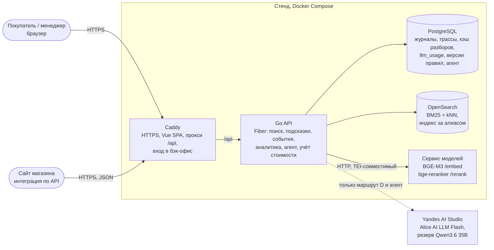
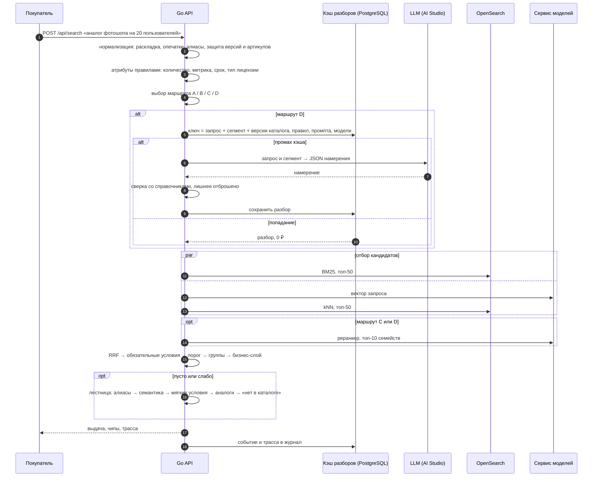
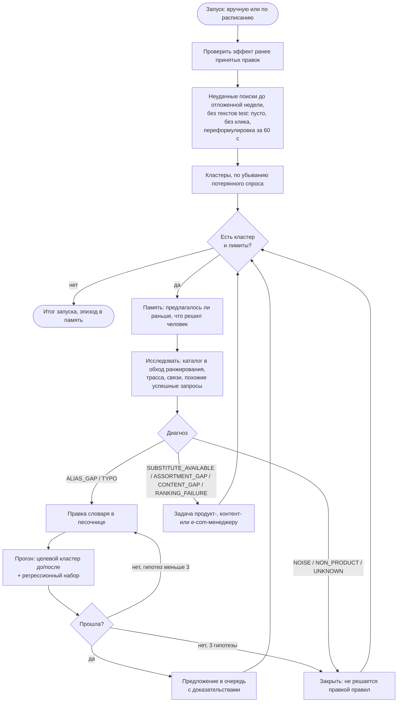
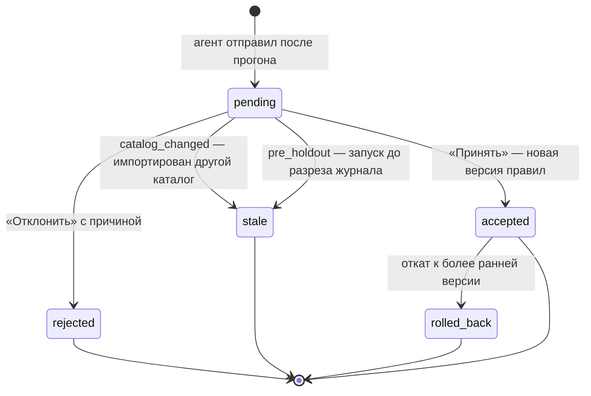
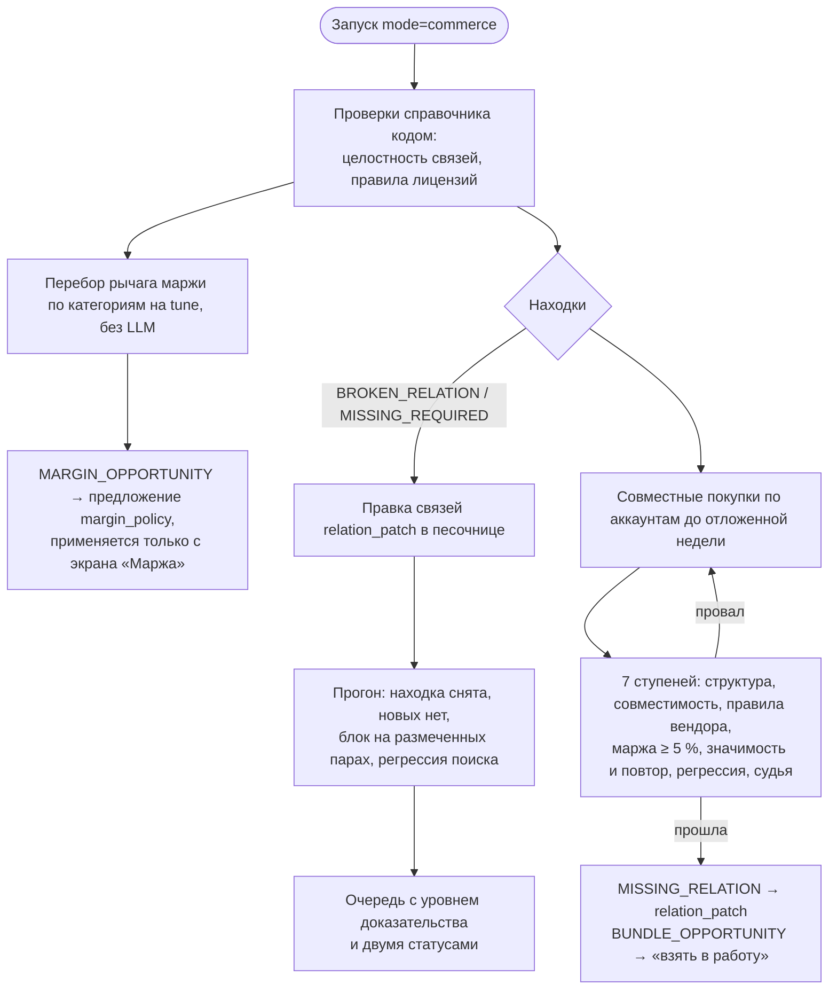

# Архитектура PLEXeT SearchOps

Две части. **Поиск** отвечает покупателю за десятки миллисекунд и объясняет каждую позицию выдачи.
**Агент SearchOps** работает в фоне: разбирает неудачные поиски, проверяет правку прогоном и отдаёт её
человеку. Сам агент ничего не меняет.

Контур коммерции добавляет поверх этого ядра модули, а не новое ядро: поиск техники, допродажу от товара-якоря,
рычаг маржи и режим агента «Коммерция» (справочник связей, статистика покупок, настройка маржи). Каждый модуль —
за флагом; флаг выключен — ответ и выдача контура поиска (проверяется тестами).

Все цифры ниже измерены на собственных mock-данных (каталог `mock-2`: 306 позиций, из них 72 оборудования;
148 связей; 381 размеченный запрос контура поиска и 120 второго; 30 дней логов; маржа и заказы синтетические),
см. [EVALUATION.md](EVALUATION.md). Данные организаторов выдаются после 26.11.

## 1. Контейнеры

| Часть | Что делает |
| --- | --- |
| Go API | Весь бэкенд: поиск, подсказки, события, аналитика, оценка, агент, учёт вызовов LLM. Один процесс |
| OpenSearch 3.9 | Полнотекстовый индекс и векторы каталога. Импорт строит новый индекс `products_v{N+1}` и атомарно переключает алиас; поиск во время импорта идёт по старому |
| Сервис моделей | BAAI/bge-m3 (эмбеддинги) и BAAI/bge-reranker-v2-m3. HTTP-интерфейс как у Text Embeddings Inference: локально — нативный сервис, на стенде — контейнер |
| PostgreSQL 19 | События, трассы, кэш разборов, учёт вызовов LLM, версии правил, запуски и шаги агента, предложения, прогоны оценки |
| Yandex AI Studio | Внешняя LLM. Вызывается только на маршруте D (при промахе кэша) и агентом |

Что выключается и как это видно:

| Нет сервиса | Поведение |
| --- | --- |
| LLM (`LLM_MODE=off`, нет ключа, исчерпан дневной бюджет или квота адреса) | Поиск отвечает на всё: маршрут D работает на кэше разборов и правилах. В трассе — причина (`budget_exceeded` для бюджета, `ip_quota` для квоты адреса). Режим переключается без перезапуска |
| Сервис моделей | Шаги `dense` и `rerank` пропущены, в трассе `skipped: true` и причина |
| OpenSearch | `/api/search` отвечает 503, `/health` — `search: down` |
| PostgreSQL | Поиск работает, но не пишет журнал |
| Блок допродажи, совместимость, маржа, шаблон решения (сбой) | Основная выдача отвечает как обычно; поле ответа пустое (`companions: null` и т. п.), в трассе шаг с `error` |

## 2. Путь запроса

### Конфигурации

Лестница B0–B4 нужна для оценки (см. [EVALUATION.md](EVALUATION.md)): B0–B3 всегда считаются на исходных
правилах, B4 — на заданной версии. Витрина по умолчанию ищет в конфигурации **`live`**: пайплайн B3 на
действующей (последней принятой) версии правил. Принятая правка словаря сразу видна покупателю: после «Принять»
«зуп» находит 1С:ЗУП первым. В трассе — `config: live`, `effective_config` и `rules_version`; в `GET /api/meta` —
`default_config: live`. Конфигурацию можно задать в запросе или адресом витрины (`?config=B3`).

### Шаги

1. **Нормализация** без LLM. Нижний регистр, раскладка (в том числе всей фразой), смешанные алфавиты,
   опечатки по словарю токенов каталога, алиасы («винда» → Windows). Версии и артикулы («2021», «8.3», «365»)
   защищены от исправлений. Исправление с высокой уверенностью применяется, и его можно отменить.
   **Достройка последнего слова**: если остальные слова понятны, а последнее (от 3 букв) — начало слова каталога,
   оно ищется как префикс: «win» → 6 семейств Windows и «Возможно, вы искали: windows». Достраивается только
   последнее слово — достройка любого слова на tune путала «монтажа видео» с видеоконференциями.
   **Транслит и фонетика** находят однозначные слова каталога: «акад лт» → AutoCAD LT, «antivirus for small
   business» → KSOS. Это не словарь сленга: незнакомые сокращения по-прежнему закрывают правки словаря.
2. **Атрибуты правилами**: «на 10 пк» → 10 устройств, «на 5 пользователей», «на год», «бессрочно»,
   «продление», «отечественный». Неясная метрика превращается в уточняющий вопрос, а не в догадку.
   **Категория по назначению**: слова из справочника категорий и короткий словарь назначения (созвон,
   видеосвязь, удалёнка, чертежи, бухгалтер, бэкап) задают категорию: «видеоконференции российские на 50» →
   TrueConf. Категория проверяется раньше количества. Маршрут она не меняет.
3. **Маршрут** — по сигналам в запросе:

   | Маршрут | Когда | Что работает |
   | --- | --- | --- |
   | A. Точный | Артикул или точное название семейства, вендора | Текстовый и векторный поиск |
   | B. Нормализованный | Сработали раскладка, опечатка, алиас или найдены атрибуты | Правила и словари |
   | C. Семантический | Сущностей каталога нет | Векторы |
   | D. Сложный | Незнакомые слова; «аналог», «замена», «вместо»; больше 5 значимых слов; нетоварный запрос; конфликт атрибутов | Кэш, затем LLM |

4. **Разбор намерения (только D)**. LLM возвращает JSON по схеме: тип намерения, продукт-референс,
   категория, вендор, обязательные и мягкие условия. Код сверяет каждое значение со справочниками и
   отбрасывает несуществующее; правила приоритетнее модели. Ошибка схемы — один повтор, затем откат на
   правила. Запрос к движку строит код, а не модель.
5. **Отбор кандидатов**: BM25 топ-50 и kNN топ-50, слияние RRF в коде Go (k = 20 для B3). На маршрутах C и D
   реранкер bge-reranker-v2-m3 оценивает 10 лучших семейств: `relevance = 0,55·слияние + 0,45·оценка реранкера` (оценка — доля от лучшей в выдаче)
   (вес — `SEARCH_RERANK_WEIGHT`, `off` выключает). На запросах «аналог X» реранкер не работает: порядок аналогов
   задают соответствие лицензии и бизнес-слой.
6. **Ранжирование** по порядку: обязательные условия (нарушение — исключение с причиной в трассе) →
   порог релевантности (0,30 от лучшего) → группы «точное / подходящее / аналог» → бизнес-слой внутри группы:
   `final = 0,80·relevance + 0,10·popularity + 0,05·margin + 0,05·context`. Бизнес-слой не поднимает товар из
   нижней группы в верхнюю. Веса не обучены: это стартовая конфигурация. Внутри группы семейство, названное
   в запросе (не меньше 60 % названия с учётом редкости слов), стоит выше других семейств того же вендора, а
   «продление» ведёт к семейству, в которое продлевается названное: «kaspersky internet security продление» →
   первым KIS, а не Kaspersky Standard. В трассе позиции — сигнал `named_family` или `renewal_path`.
   **Бизнес-масштаб**: при количестве от 10 или у клиента-организации (сегменты smb, enterprise, gov) домашние
   линейки стоят ниже бизнес-линеек (сигнал `consumer_scale`): «касперский на 1000 пк» → KES, KSOS; лицензия
   ровно на запрошенное количество (от 2) — выше поштучной: «офис на 30 мест» → Р7-Офис на 30 мест.
   **Хвост**: семейство другой категории и другого вендора со скором ниже 0,7 от первой позиции (0,5 для соседней
   категории того же раздела) уходит в отказы — «винда 11 про» больше не показывает Acrobat Pro и Zoom Pro.
7. **Лестница пустой выдачи**: подтверждённые алиасы → семантика → ослабление мягких условий (покупателю
   пишется, что ослаблено) → аналоги из справочника с пометкой → честное «нет в каталоге» и кнопка
   менеджера. Обязательные условия молча не ослабляются. Аналоги даются, только если в запросе есть хотя бы одно
   понятное значимое слово: на `` — честное «нет», а не три Windows как «аналоги».
8. **Ответ**: выдача, чипы «как мы поняли запрос», связанные запросы, блок «С этим покупают», трасса. Контур коммерции добавляет строку обязательного, блок «Дополните решение», шаблон решения, старшую редакцию и фасеты —
   см. ниже.

Пороги подобраны на настроечном наборе: порог релевантности 0,30; кандидат только из векторов — скор kNN
не ниже 0,745; аналог отсутствующего товара — не ниже 0,76; RRF k = 20.

Реранкер на tune поднял NDCG@10 B3 с 0,933 до 0,947 без ухудшений, на test — с 0,870 до 0,882. Цена — время:
P95 на маршрутах C и D ~170 мс против ~30 мс на A и B. Сбой реранкера не ломает поиск: выдача без него, в
трассе шаг `rerank` со `skipped: true` и причиной.

### Трасса

Каждый ответ несёт трассу и сохраняется в `search_traces`: шаги с временем, маршрут, источник разбора
(`rules`, `cache`, `llm`), разложение итогового скора по слагаемым, отсечённые товары с причиной
(`license_metric_mismatch`, `below_threshold`, `vendor_mismatch`, `category_mismatch` и др.), стоимость запроса.
Молча ничего не отсекается: «нет в каталоге» с далёкими аналогами (`absent_not_close`), аналоги сверх пяти
ближайших (`absent_tail`), шум хвоста (`tail_low_relevance`), запрос без смысла или не о товаре (`noise_query`) —
всё это тоже в `rejected` с причиной. Пропущенный шаг
остаётся с `skipped: true` — по трассе видно, что модель не вызывалась. Трассу показывает экран «Поиск»,
по ней же строятся аналитика, учёт стоимости и вход агента.

### Контекст клиента

Сегмент и история покупок входят в бизнес-слой (слагаемое `context`). Явно написанное в запросе важнее
истории. Пример: «продлить антивирус» у клиента с купленным KSOS на 10 ПК — первым его продление, у клиента
без истории — общая выдача. Персонализированные разборы в общий кэш не смешиваются: сегмент входит в ключ.

### Контур коммерции: оборудование, допродажа, маржа

Новые шаги встают в тот же путь запроса. LLM ни в одном из них не вызывается: запрос по оборудованию на маршрут D
не уходит, блок допродажи читает готовые связи и правила.

| Шаг | Флаг | Что делает |
| --- | --- | --- |
| `hardware` | `FEATURE_HARDWARE` | Парт-номер (токен или 2–3 соседних, кириллические двойники → латиница, без «исправления опечаток») ищется отдельным точным полем: целиком, по началу и по триграммам, отдельным списком RRF. Числа с единицами («32 гб», «24-27 дюймов», «144 гц»), диапазоны, цена («до 100 000 рублей»), отрицания («без ОС», «не Dell»), количество закупки («20 ноутбуков») — условия и фильтры. «X для Y» — фильтр по правилам совместимости с моделью: подтверждённые выше условных, несовместимые и неизвестные — в отказах трассы. Фасеты по характеристикам категории. Точный парт-номер — маршрут A, маржа его не двигает |
| `margin` | `FEATURE_MARGIN_POLICY` | Перестановка внутри групп релевантности по перцентилю маржи в категории: сдвиг не больше 2 позиций, первая позиция точного запроса неподвижна, переход между группами запрещён. Вес 0,05 = выдача контура поиска. Работает только на витрине (`live`); шаг виден только в сохранённой трассе бэк-офиса |
| `companions` | `FEATURE_COMPANIONS` | Якорь — первое точное семейство (или названное в запросе семейство, к которому найденное — условно обязательное: в «windows server 2025 standard на 50 пользователей» якорь — сервер). Кандидаты — только связи якоря; совместимость — по правилу модели, затем по правилу лицензии вендора, затем по связи, иначе `unknown`. Правило вендора сильнее связи: CAL 2022 к серверу 2025 несовместима, даже если связь говорит «подтверждено». Условно обязательное — в `items[].required` с условиями и количеством из запроса; остальное — блок `companions`, 2–4 позиции по одной на класс. Несовместимое и снятое с продажи не показывается никогда; нет уверенного якоря — блока нет, причина в трассе |
| `solution` | `FEATURE_SOLUTIONS` | Триггер утверждённого шаблона («рабочее место», «филиал») находится правилами; слоты заполняет тот же поиск с условиями слота и запроса; количество — самая дешёвая фасовка под N мест. Основная выдача не меняется |
| `upgrade` | `FEATURE_SOLUTIONS` | Утверждённая связь «старшая редакция» от первой точной позиции и что добавится (Standard → Datacenter). Позиция найденного товара не меняется, в блок дополнений не попадает |

Единственное место, где флаг допродажи меняет порядок основной выдачи: «на N пользователей» при названном
сервере с правилом лицензии per_user/per_device — это количество лицензий доступа, а не условие выдачи. Сервер
первым, CAL 2025 × 50 в строке «Проверьте необходимость». На mock срабатывает на 3 запросах p2 и ни на одном
запросе контура поиска.

Скорость: шаг `companions` — меньше 0,1 мс; шаг `solution` — P50 13,7 мс, максимум 504 мс (холодный). P95 поиска
на p2 с блоком и без — 10,4 и 5,6 мс (локально, разница в пределах шума общей машины).

## 3. Агент SearchOps

Цикл вызова инструментов на Go. Модель (Alice AI LLM Flash, нативные `tool_calls`) выбирает инструмент,
код проверяет аргументы по типизированной схеме, выполняет и пишет шаг в `agent_steps`. Ход запуска
транслируется в интерфейс по SSE. Python-фреймворки и несколько агентов не используются.

**Инструменты (15)**, все детерминированы, у агента нет SQL, shell и записи в боевой индекс:
`get_failed_queries`, `get_query_cluster`, `search_catalog`, `get_active_rules`, `get_search_trace`,
`find_similar_successful_queries`, `get_product_details`, `get_product_relations`, `get_previous_decisions`,
`create_sandbox_patch`, `run_evaluation`, `submit_proposal`, `create_assortment_ticket`, `close_cluster`,
`verify_applied_change`.

**Что видит агент.** Журнал поисков только до начала отложенной недели (по умолчанию последние 7 дней журнала,
`AGENT_HOLDOUT_FROM`, `AGENT_HOLDOUT_DAYS`) и без текстов замороженного test (`AGENT_EXCLUDE_TEST`). При
разрезе по умолчанию граница — последний исторический поиск журнала минус неделя, и живые поиски стенда агенту
не видны; чтобы он их разбирал, разрез задают датой или выключают (`off`). Эффект его
правок меряется реплеем отложенной недели — см. [EVALUATION.md](EVALUATION.md#эффект-агента). Потерянный
спрос кластера считается по различным сессиям, а не по поискам: один человек, повторивший запрос десять раз,
не делает кластер важнее.

**Песочница.** Правка живёт как снимок правил и прогоняется через тот же сервис поиска, что и боевой
запрос, без записи в журнал. Допуск: целевой кластер улучшился, точные запросы не ухудшились, новых
нарушений условий лицензии нет, на наборах tune и regression ухудшений не больше порога (по умолчанию 0).

**Ограничители** (в коде): 15 вызовов инструментов на кластер, 3 гипотезы, 600 тыс. токенов на запуск,
25 минут на запуск, 6 минут на кластер, от 1 до 12 кластеров, дневной бюджет LLM. Если кластер упёрся в
лимит вызовов, запуск честно завершается с `stop_reason: step_limit`, исчерпан бюджет — `budget_limit`.
Синоним на продукт другого производителя отклоняется кодом до прогона; производителя термина определяет код по
данным (слово, клики после переформулировок, поиск по каталогу), а не модель. Расписание по умолчанию выключено
(`AGENT_SCHEDULE`).

`RANKING_FAILURE` — товар есть в каталоге и в выдаче, но стоит не первым: например, по «кис продление»
первым идёт Kaspersky Standard, а не Kaspersky Internet Security. Это задача менеджеру e-com, а не правка
словаря.

**Память**: журнал предложений со статусами; решения человека с причиной («не предлагать снова»); эпизоды
запусков с эффектом принятых правок. Второй запуск начинает с проверки эффекта принятых правок и не
предлагает того, что человек отклонил.

### Состояния предложения

`stale` — предложение ждало решения, но принять его уже нельзя; причина — в `stale_reason` (в базе
`decided_reason`):

| Причина | Когда | Кто ставит |
| --- | --- | --- |
| `catalog_changed` | импорт с другим `catalog_version`: правка проверялась на прежнем словаре | импорт, под тем же advisory-замком, что и новая версия правил |
| `pre_holdout` | запуск агента до разреза журнала видел отложенную неделю и тексты test — правка подобрана под них | человек: `go run . proposals stale --run <id> --reason "…"` (только `pending`, текст — в `decided_comment`) |

Старые строки без `decided_reason` читаются как `catalog_changed`. Принятые правки таких запусков не переводятся
в `stale`: они остаются в версии правил, а `/api/effect` и `/api/evaluations` (`agent_credit.pre_holdout`) помечают
B4 как не независимую оценку и не засчитывают вклад агента.

Решение человека пишется в память агента. Задача (`action: ticket`) принимается той же кнопкой, но версию
правил не создаёт. Отклонение требует причину: `too_broad`, `wrong_product`, `not_now` или `other` с
комментарием.

**Перепроверка при принятии.** Если с момента прогона агента правила сменились (кто-то принял другую правку),
«Принять» сначала прогоняет правку на действующих правилах. Не прошла — 409 `CONFLICT` с причинами, предложение
остаётся в очереди, результат перепрогона записан в доказательства (`evidence.recheck`). Прошла — правка
применяется.

**Версии правил.** Каждая принятая правка — новая версия. Откат создаёт ещё одну версию (копию целевой) и
не стирает историю; предложения, принятые после целевой версии, становятся `rolled_back`. Одновременная
запись двух человек — 409 `CONFLICT` (оптимистичная блокировка). Версии правил привязаны к версии каталога:
импорт другого каталога архивирует прежнюю цепочку и начинает новую, ждущие предложения становятся `stale`
(причина `catalog_changed`) и принять их нельзя; откат к архивной версии — 409. Повторный импорт того же
каталога версии не сбрасывает.

### Режим «Коммерция»

Тот же цикл, тот же журнал шагов, та же очередь и решение человека. Запуск — `POST /api/agent/runs
{"mode":"commerce"}`, промпт `agent-commerce-v1`, лимит 10 вызовов на находку и 3 гипотезы.

- **Справочник связей** — детерминированно: связь на отсутствующую или снятую позицию, связь, которую запрещает
  правило лицензии вендора (версия CAL ниже сервера) или правило совместимости, правило «условно обязательно» без
  связи. Модель пишет правку и объяснение; код не даёт править чужое: удалять и менять — только связь находки,
  добавлять — только от якоря правила. Текст карточек подаётся модели как помеченные непроверенные данные:
  описание товара не доказательство совместимости.
- **Статистика покупок** — уровень семейства, единица — аккаунт: односторонний точный тест Фишера, поправка
  Бенджамини — Хохберга (q ≤ 0,01), не меньше 3 аккаунтов; отсев заменителей, одной категории, повсеместных
  дополнений и производных пар. Повтор на последних 7 днях заказов, которые статистика не видела. Судья
  Qwen3.6 35B — другого семейства, фильтр только на отказ. Очередь сортируется по оценке приоритета в рублях
  (подпись «оценка приоритета, не прогноз»).
- **Настройка маржи** — следующее положение рычага для категории предлагается, только если качество набора tune не
  ниже, первое место точных запросов не меняется, ни один запрос не теряет больше ε, а индекс показанной маржи
  растёт. `POST /api/margin/simulate` с параметрами из предложения воспроизводит те же числа.
- **Версии связей** — `config_versions.kind = relations`, своя цепочка, независимая от правил и маржи. Принятая
  правка связей сразу действует в блоке допродажи и словаре поиска; откат — `POST /api/relations/rollback`,
  принятые после целевой версии правки становятся `rolled_back`, повторный запуск находит проблему снова.

## 4. Данные

| Таблица | Что хранит |
| --- | --- |
| `products`, справочники | Каталог: позиции SKU-уровня, семейства, вендоры, категории, связи, алиасы, клиенты |
| `search_events` | Поиск: запрос, маршрут, число результатов, версия правил, клиент, сессия, источник (`live`, `compare`, `mock_log`) |
| `search_traces` | Трасса каждого поиска |
| `behavior_events` | Клик, корзина, заказ, запрос цены, обращение к менеджеру |
| `intent_cache` | Кэш разборов маршрута D |
| `llm_usage` | Каждый вызов модели: токены, задержка, стоимость, версия прайса, статус, связь с поиском или запуском агента |
| `config_versions` | Версии правил, связей и политики маржи (`kind`: rules, relations, margin; цепочки независимы) |
| `license_rules`, `compatibility_rules`, `attribute_definitions`, `solution_templates` | Правила лицензий вендоров, совместимость с моделями (verified / conditional / incompatible), характеристики категорий с единицами, шаблоны решений |
| `quote_requests` | Запросы КП со спецификацией |
| `catalog_infos` | Версия каталога и какие поля в нём синтетические (плашка «Синтетические данные») |
| `issue_clusters` | Кластеры неудачных запросов |
| `agent_runs`, `agent_steps` | Запуски агента и их шаги |
| `proposals`, `decisions` | Предложения и решения человека с причиной |
| `evaluations`, `judge_runs` | Прогоны оценки и LLM-судьи |

Каталог импортируется за интерфейсом источника: сейчас реализован один источник — mock-JSON из
`data/mock/`. Для данных магазина нужен свой адаптер (см. [PILOT.md](PILOT.md)). Формат — `data/README.md`.

Индекс контура коммерции: парт-номер — отдельное поле с нормализатором (верхний регистр, без пробелов, дефисов и
косых), начальными n-граммами и триграммами: обычный анализатор режет «SNS-R740-32G» на куски по дефисам.
Характеристики — числовые поля `specs.<ключ>`, ключи — из характеристик категорий. У ПО этих полей нет.

## 5. API

Полное описание — [openapi.yaml](openapi.yaml). Префикс `/api`, JSON.

| Метод | Назначение |
| --- | --- |
| `POST /api/search` | Выдача и трасса. Конфигурация `live` (по умолчанию) или B0–B4, клиент, снятые чипы, ответ на уточняющий вопрос |
| `GET /api/suggest` | Подсказки: запросы, товары, вендоры, категории |
| `POST /api/events` | Клик, корзина, заказ и др. Событие поиска пишет сам `/search` |
| `GET /api/traces/{id}` | Сохранённая трасса |
| `GET /api/meta` | Режим LLM, версии каталога и правил, конфигурации, клиенты |
| `POST /api/catalog/import` | Переимпорт каталога и справочников из настроенного источника |
| `GET /api/analytics?role=` | Показатели, воронка, проблемные запросы с выводом агента; блоки ролей `ecom`, `product`, `content`, `head` |
| `GET /api/analytics/current` | Что действующий поиск отвечает на проблемные запросы сейчас: поиск без записи в журнал, кэш 10 мин |
| `GET /api/evaluations`, `POST /api/evaluations/run` | Прогоны оценки и согласие LLM-судьи |
| `GET /api/costs`, `GET /api/costs/export` | Прайс, стоимость по маршрутам, кэш, журнал вызовов модели, месячные сценарии 20 и 200 тыс. запросов; экспорт — CSV для шаблона расчёта |
| `GET /api/effect` | Вилка эффекта в заказах и рублях (три сценария) с замерами и допущениями; то же в `GET /api/analytics?role=head` |
| `POST /api/admin/llm-mode` | Режим LLM `on`/`off` без перезапуска (при `ADMIN_ENABLED`) |
| `POST /api/agent/runs`, `GET /api/agent/runs/{id}` (+ `/stream`, `/stop`) | Запуск агента (`mode`: search — неудачные поиски, commerce — связи, покупки, маржа), шаги, поток SSE, остановка |
| `GET /api/agent/memory` | Память агента |
| `GET /api/proposals`, `POST /api/proposals/{id}/approve\|reject` | Очередь предложений |
| `GET /api/configs`, `POST /api/configs/rollback` | Версии правил и откат |
| `POST /api/quotes`, `GET /api/quotes` | Запрос КП со спецификацией (витрина); список запросов (бэк-офис). Цены берёт сервер, сумма — только если известны все цены |
| `GET /api/companions?product_id=&quantity=` | Обязательное, дополнения и старшая редакция к позиции («К этой позиции: …» в спецификации) |
| `GET /api/margin/policy`, `POST /api/margin/policy`, `POST /api/margin/policy/rollback` | Политика маржи: вес, веса категорий, упор, версии; применение (за упором — 422) и откат |
| `POST /api/margin/simulate`, `GET /api/margin/simulate/status` | Симуляция положений рычага на размеченном наборе: качество, индекс маржи, сработавшие защиты, затронутые запросы |
| `GET /api/relations`, `GET /api/relations/versions`, `POST /api/relations/rollback` | Справочник связей, версии с разницей, откат |
| `GET /api/evaluations/commerce?set=p2` | Коммерческая лестница C0–C4 и прогоны с одним изменением |
| `GET /api/effect/commerce` | Модель эффекта допродаж: механизмы, вычеты, тождество, источник каждого входа |

Ошибка всегда `{"error":{"code","message","traceId"}}`; `traceId` совпадает с заголовком `X-Request-Id`.
Ответы не кешируются. Без входа доступны только методы витрины: `GET /api/health`, `/api/meta`, `/api/suggest`,
`/api/evaluations`, `/api/evaluations/commerce`, `/api/companions` и `POST /api/search`, `/api/events`,
`/api/quotes`; остальное — бэк-офис, нужен токен (см. раздел 7).
Изменяющие запросы принимаются только с `Origin`, равным адресу витрины. Строка поискового запроса в журнал
приложения не пишется. Лимит — 600 запросов в минуту с адреса (`RATE_LIMIT_PER_MIN`, сверх — 429
`TOO_MANY_REQUESTS`), срок обработки запроса — 25 с (кроме SSE и импорта).

## 6. Почему так

**OpenSearch, а не Elasticsearch.** В OpenSearch гибридный поиск и kNN входят в сборку под Apache 2.0.
В Elasticsearch RRF и linear retriever требуют платной лицензии. Слияние RRF мы всё равно делаем в коде Go:
так его проще трассировать, и выбор движка не зависит от лицензии.

**LLM только на маршруте D.** Модель нужна запросам со смыслом («аналог фотошопа на 20 пользователей»), а не
«windows 11 pro». На test-наборе с весами частот маршрут D — 23,6 % поисков, остальные обслуживаются без модели
за ~25 мс (P50). Разбор моделью — 2,55 с (медиана) и 0,135 ₽; повтор из кэша — ~32 мс и 0 ₽. Каскад даёт
скорость и предсказуемость; без внешнего API поиск продолжает работать.

**Модель возвращает структуру, а не запрос к движку.** На «отечественный офис на 30 компов бессрочка» Flash
вернул вендора «отечественный» — такого нет. Код отбросил поле и превратил его в фильтр «российское ПО».
В другом разборе модель предложила референс Notion — его нет в каталоге, код отбросил.

**Порог вместо «всегда что-то показать».** Векторный поиск без порога (B2) даёт 0 % пустых выдач, но на
запросы о товарах, которых нет (ChatGPT, Figma), показывает что угодно: ложное спасение 100 %. С порогом (B3)
пустых 7,4 %, ложное спасение 16,7 %. Пустой ответ с аналогами и кнопкой менеджера честнее, и он фиксирует
неудовлетворённый спрос для агента.

**Агент не применяет правки сам.** Правка словаря меняет выдачу всем покупателям. Агент автономен в
исследовании, выборе инструментов, проверке и пересмотре гипотезы; применение — решение человека, с
версией и откатом. Пример: «акад» → AutoCAD отклонена прогоном (ломала «акад лт»), «акад лт» → AutoCAD LT —
тоже (стало хуже), обе вместе прошли: 3/6 → 5/6, регрессия 0 из 216. Но прогон той же правки на test
показал ухудшение «автокад лт» (NDCG −0,29), которого регрессионный набор агента не видел. Решение с этим
знанием — за человеком.

**Модели эмбеддингов свои, а не облачные.** Пороги релевантности настроены на векторах BGE-M3; облачные
эмбеддинги их бы сдвинули. Плюс каталог и запросы не уходят наружу ради векторов.

**Допродажа по правилу, а не по модели.** LLM не назначает связи и не подтверждает совместимость: одна
несовместимая позиция в блоке подрывает доверие ко всем. Блок строится от уверенного якоря по утверждённым связям и
правилам вендоров; нет якоря — нет блока, а не добор популярными товарами. «Неизвестно» не равно «совместимо».
Обязательное — «условно обязательное»: у покупателя лицензии могут уже быть, поэтому ничего не выбрано заранее.

**Один рычаг маржи с защитами.** Четыре свободных веса менеджеру не нужны: большинство их сочетаний недопустимы.
Одно положение рычага проверяется на размеченных запросах до применения; упор стоит там, где хотя бы один запрос
теряет больше ε. Невидимая перестановка своего каталога внутри групп релевантности не выделяет товары визуально.

**Без обучения ранжированию.** В логах нет позиций показов, поэтому отсутствие клика не значит
нерелевантность, а на mock-логах модель легко переобучить. Веса бизнес-слоя — исходная конфигурация.

## 7. Модель угроз

Что защищаем и чем. «В коде» — проверка в Go, а не в инструкции модели.

| Угроза | Защита | Где |
| --- | --- | --- |
| Чужой меняет правила, запускает агента, читает аналитику | Вход в бэк-офис: `BACKOFFICE_TOKEN` (не короче 24 символов; в production без него API не стартует). Браузер входит через basic_auth в Caddy, пароль — тот же токен; скрипты шлют `Authorization: Bearer <токен>`. Закрыто всё, кроме методов витрины; новый маршрут закрыт по умолчанию. Сравнение токена — за постоянное время | Caddy, Go API |
| Подделка запроса со страницы другого сайта (CSRF) | Изменяющие запросы — только с `Origin`, равным `PUBLIC_ORIGIN` | Go API |
| Перегрузка | 600 запросов в минуту с адреса (429), срок обработки 25 с | Go API |
| Один клиент выжигает бюджет LLM | Квота адреса: разборы маршрута D (промахи кэша) — до 20 ₽ в сутки с адреса (`LLM_PER_IP_DAILY_RUB`; IPv6 — на сеть /64, а не на адрес), сверх — правила и кэш, причина `ip_quota`. Одинаковые параллельные промахи кэша ждут один вызов модели (singleflight по ключу кэша). Дневной бюджет 1 000 ₽ (`LLM_DAILY_BUDGET_RUB`), из него 100 ₽ (`AGENT_BUDGET_RESERVE_RUB`) разборы покупателей не тратят — это резерв агента | Go API |
| Инструкция в запросе покупателя | Запрос уходит модели как данные в JSON-строке; ответ — структура, каждое значение сверяется со справочниками, несуществующее отбрасывается; запрос к движку строит код. Тест `TestInjectionAndNoClientIDs` | Go API |
| Агент поддался инструкции в данных | Нет SQL, shell и записи в боевой индекс; только 15 известных инструментов, аргументы проверяет код — и для нативных вызовов, и для записанных текстом. Производителя термина определяет код по данным; `canonical` правки сверяется со словами названия цели; синоним на чужого производителя отклоняется до прогона. Правку применяет человек | Go API |
| Подделка «различных сессий» и кликов для доказательств агента | Сессию выдаёт сервер: `GET /api/meta` отдаёт токен `s-<16 hex>.<HMAC>`; в журнал поисков и событий попадает только номер с верной подписью, самодельный `session_id` — как «без сессии». Ключ — производный от `BACKOFFICE_TOKEN` | Go API |
| Правка, проверенная на старых правилах | Перепроверка при «Принять» (409 при провале) | Go API |
| Утечка маржи | Маржа — только в методах бэк-офиса и сохранённой трассе; из ответа `POST /api/search` шаг `margin` вырезается всегда | Go API |
| Инструкция в описании товара для агента «Коммерции» | Описание передаётся как `description_untrusted`; утверждение из описания не считается доказательством совместимости; правку агент может сделать только в связи своей находки | Go API |
| Несовместимое в блоке допродажи | `incompatible` и снятые позиции не попадают в блок никогда; правило вендора сильнее связи; метрика нарушений на размеченных парах | Go API |

Ограничения защиты:

- Квота адреса считается в памяти процесса: сбрасывается перезапуском и в полночь по Москве. Она касается
  только разборов из `POST /api/search`; агент, оценка и прогрев под неё не попадают.
- В development токен по умолчанию пуст — вход выключен, ключ подписи сессий случайный на процесс (после
  перезапуска фронт получает новую сессию из meta).
- Подписанные сессии не мешают одному адресу набрать много сессий повторными `GET /api/meta` (их сдерживает только
  лимит частоты); они закрывают выдуманные номера, а не перебор. Параллельные промахи с одного адреса с разными
  запросами проходят проверку квоты вместе (списание — после вызова).
- Инъекция через карточку каталога отдельным тестом не проверялась.

## 8. Чего нет

- Стенд не развёрнут: всё работает и измерено локально. Продовый compose пока без OpenSearch и сервиса моделей.
- Источник каталога — только mock-JSON; адаптера под формат магазина нет.
- Задержки и память BGE-M3 на CPU стенда не измерены (локально на CPU: вектор запроса 49 мс).
- Обучения ранжированию нет; реранкер работает только на маршрутах C и D.
- Честный вклад правок агента в метрики на mock-данных — 0: запуск без доступа к отложенной неделе и текстам
  test правок не предложил — см. [EVALUATION.md](EVALUATION.md#эффект-агента).
- Вилка эффекта в рублях есть только в API (`/api/effect`); экран руководителя показывает долю спасённых.
  Цифры вилки — на mock-логах, фактический эффект измеряется A/B-тестом в пилоте.
- В шапке интерфейса виден режим LLM (вкл/выкл), но не исчерпанный бюджет: его отдаёт `GET /api/meta` (`llm.budget`, `llm.banner`).
- Тест на внедрение инструкций есть для запроса и ответа модели и для аргументов агента; через карточку
  каталога — нет.
- Контур коммерции: маржа и заказы в mock-данных синтетические; ноль несовместимых пар — на 149 размеченных парах,
  не на всём каталоге; точность блока по LLM-судье не считалась; в песочнице агента словарь аналогов не
  подменяется (правка связи-заменителя влияет на ранжирование только после принятия); источник данных магазина
  пока не читает номер заказа и аккаунт из журнала событий и размеченные пары блока.
