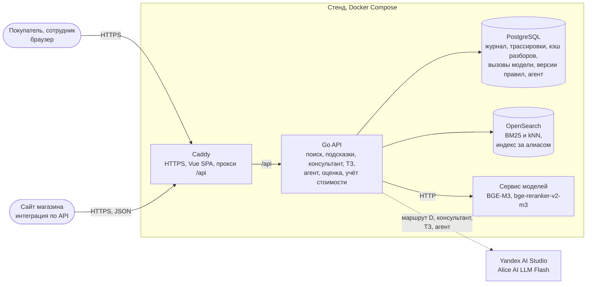
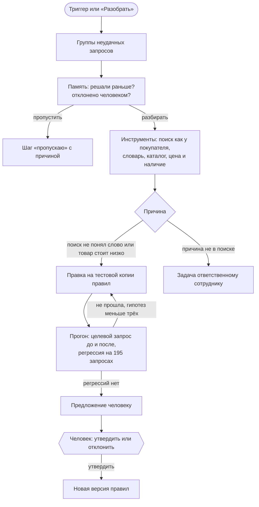
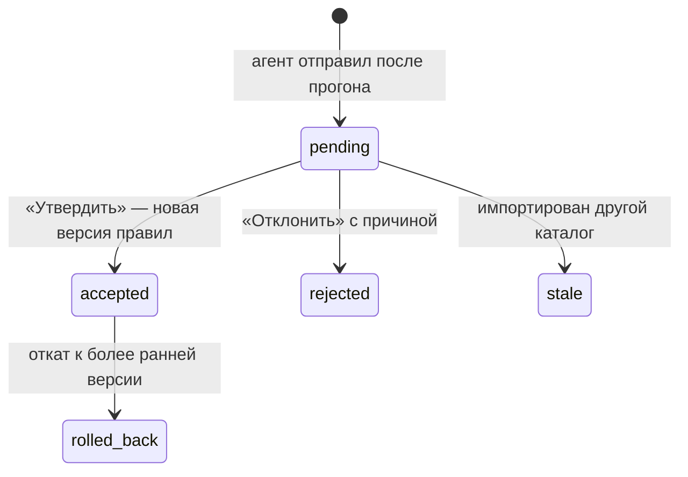

# Архитектура PLEXeT SearchOps

Решение состоит из четырёх частей.

- **Поиск** отвечает покупателю и объясняет каждую карточку выдачи.
- **ИИ-консультант** ведёт подбор в окне переписки: уточняет задачу, сравнивает редакции, считает лицензию.
- **Поиск по ТЗ** разбирает документ закупки на позиции и ищет по каждой.
- **Агент SearchOps** работает в фоне: разбирает неудачные поиски, проверяет правку прогоном и отдаёт её человеку. Сам
  агент ничего не применяет.

Документ описывает решение на фиде заказчика: 136 040 предложений, 4 413 семейств, 1 232 вендора. Числа взяты из
сохранённых прогонов, методика и оговорки — в [EVALUATION.md](EVALUATION.md). Модули, которым нужны данные, которых в
фиде нет, собраны в разделе [«Модули учебного каталога»](#модули-учебного-каталога).

## Контейнеры



| Часть | Что делает |
| --- | --- |
| Go API | Весь бэкенд в одном процессе: поиск, подсказки, режим подбора, поиск по ТЗ, события, агент, оценка, учёт вызовов модели |
| OpenSearch | Текстовый индекс и векторы каталога. Импорт строит новый индекс и атомарно переключает алиас; поиск во время импорта идёт по прежнему индексу |
| Сервис моделей | Эмбеддер BGE-M3 и реранкер bge-reranker-v2-m3 на своём сервере. Платы за вызов нет |
| PostgreSQL | Журнал поиска и событий, трассировки, кэш разборов, учёт вызовов модели, версии правил, запуски и шаги агента, предложения, прогоны оценки |
| Yandex AI Studio | Внешняя языковая модель Alice AI LLM Flash. Вызывается на маршруте D при промахе кэша, в ходе консультанта, при разборе ТЗ и агентом |

Один адрес для интерфейса и API, без CORS. Как развернуть стенд, описано в [DEPLOY.md](DEPLOY.md).

Что происходит, когда часть недоступна:

| Нет сервиса | Поведение |
| --- | --- |
| Языковая модель (`LLM_MODE=off`, нет ключа, исчерпан дневной бюджет или квота адреса) | Поиск отвечает на всё: маршрут D работает на кэше разборов и правилах, причина записана в трассировке. Консультант отдаёт запасной ответ со списком найденного |
| Сервис моделей | Шаги векторов и реранкера пропущены, выдача строится по тексту и правилам; в трассировке у шага отметка о пропуске и причина |
| OpenSearch | `POST /api/search` отвечает 503, `/health` показывает `search: down` |
| PostgreSQL | Поиск работает, но не пишет журнал |

## Данные каталога

Каталог приходит из фида магазина через универсальный источник (`DATA_SOURCE=generic`) и файл соответствия полей
`data/softline/mapping.yaml`. Конвертер `scripts/data/softline_feed.py` переводит фид в JSONL и пишет отчёт сверки
[data/softline/FEED_STATS.md](../data/softline/FEED_STATS.md). Другой каталог подключается своим файлом соответствия без
правки кода.

| Что | Как устроено |
| --- | --- |
| Семейство | Предложения одного продукта с общей страницей на сайте. В выдаче семейство занимает одну карточку, варианты лицензии лежат внутри. У оборудования семейство совпадает с товаром |
| Цена | Показывается только у предложения в наличии с ценой больше нуля: таких 44 601, это 32,8 %. Остальные идут с кнопкой «Запросить цену» |
| Адреса страниц семейств | Собраны с сайта, 1 808 из 1 809 ([data/softline/FAMILY_URLS.md](../data/softline/FAMILY_URLS.md)) |
| Векторы | По одному на семейство программ и на каждый товар оборудования. Варианты внутри семейства различают правила и текстовый поиск |
| Файлы рядом с фидом | `data/softline/`: словарь соответствий `lexicon.csv`, документы совместимости `compat_docs.csv`, акции `promos.csv`, классы допродажи `upsell_classes.csv` и `upsell_links.csv`, справочник «С этим покупают» для оборудования `relations.csv`, база знаний `kb/`. Читаются при старте API |
| Чего в фиде нет | Маржи (0 у всех), продаж и кликов (популярность 0,5 у всех), заказов, логов поиска, истории покупателей |

## Путь запроса

Порядок шагов задан в коде и одинаков для всех запросов. Каждый шаг пишет запись в трассировку.

```
запрос → нормализация: раскладка, опечатки, транслит, слитное написание, склонения
       → словарь соответствий: жаргон, написание, ребрендинг, замена ушедшего продукта
       → категорийный запрос: «сервер» ведёт в Rack-серверы, другие смыслы показаны уточнениями
       → маршрут A, B, C или D; языковая модель только на D, её ответ сверяется со справочником каталога
       → BM25 и векторы BGE-M3 → слияние по местам (RRF) → порог релевантности → реранкер на C и D
       → свёртка в семейства → итоговое ранжирование → вариант по умолчанию
       → целевая страница → добор выдачи до четырёх семейств → «Дополните решение», скидки и акции
       → ответ, трассировка, событие в журнал
```

### Понимание запроса

1. **Нормализация** без языковой модели: регистр, чужая раскладка, опечатки по словам каталога, транслит, слитное
   написание, приведение слов к основе для склонений. Версии и артикулы («2021», «8.3», «365») от исправлений
   защищены. Код: `backend/services/search_normalize.go`, `search_understanding.go`.
2. **Словарь соответствий** `data/softline/lexicon.csv`: 99 записей, у каждой тип связи и основание. Типы связи:
   жаргон, написание, ребрендинг, замена ушедшего продукта, исключение. Запись без основания не загружается. Замену
   ушедшего продукта поиск не подставляет молча: карточки замены показываются с пояснением. Исходная версия правил
   содержит ещё 490 алиасов, из них 426 взяты из адресов страниц вендоров на сайте магазина.
3. **Категорийный запрос.** Если главное слово запроса совпадает с названием категории каталога, основная выдача
   берётся из этой категории, а другие смыслы показываются уточнениями над выдачей.
4. **Атрибуты правилами.** Срок, количество и тип лицензии из текста запроса сужают варианты так же, как фильтры.
5. **Маршрут** выбирают правила:

   | Маршрут | Когда | Языковая модель |
   | --- | --- | --- |
   | A | Товар назван точно | нет |
   | B | Поиск исправил слово или нашёл условия | нет |
   | C | Описана задача без названий | нет |
   | D | Запрос трудный | да, при промахе кэша |

6. **Разбор намерения на маршруте D.** Модель получает до 15 категорий и 20 вендоров, совпавших со словами запроса, из
   551 и 1 232, и возвращает типизированную структуру. Запрос к поисковому движку она не пишет. Код сверяет каждый
   идентификатор с полным справочником и отбрасывает выдуманные. Разбор кэшируется. Код: `intent.go`,
   `intent_context.go`, промпт `backend/prompts/intent.md`.

Маршруты A–D — маршрутизация правилами. Агентом мы их не называем.

### Поиск кандидатов

Текстовый поиск BM25 и векторный поиск работают параллельно, каждый отдаёт до 50 кандидатов. Списки сливаются по
местам: позиция получает сумму дробей `1 / (k + место в списке)`, `k` = 20 в полной конфигурации. Оценки двух методов
при этом сравнивать не нужно. Слияние выполняет код на Go, поэтому его шаги видны в трассировке.

Дальше работают порог и реранкер.

- **Порог релевантности** 0,3 от лучшей оценки. Если порог не прошёл ни один кандидат, поиск сообщает, что подходящего
  нет, и не подставляет ближайший товар по векторам.
- **Реранкер** заново оценивает пары «запрос и карточка» для первых десяти семейств. Он работает на маршрутах C и D,
  но не на запросах-аналогах и не тогда, когда семейств меньше двух. Доля его оценки в релевантности задаётся
  настройкой `SEARCH_RERANK_WEIGHT`, по умолчанию 0,45.

### Ответ

**Итоговое ранжирование.** Карточки с одинаковым типом совпадения упорядочиваются по формуле

```
S = 0,8 × R × (0,5 + 0,5 × F) + 0,1 × P + 0,05 × M + 0,05 × C
```

`R` — релевантность после слияния и реранкера; `F` — соответствие лицензии условиям запроса; `P` — популярность; `M` —
маржа; `C` — контекст клиента. Веса выбраны нами и не обучались. В данных заказчика популярность у всех 0,5, маржа 0,
поэтому эти слагаемые порядок не меняют. Формула оставлена целиком и примет данные магазина без переделки.

**Контекст клиента** включён всегда. У вошедшего демо-покупателя купленные лицензии стоят выше и помечены «Вы
покупали». Истории покупок от заказчика нет: механизм показан на трёх демо-покупателях с вымышленной историей
(`data/softline/purchases.csv`). Для гостя слагаемое равно нулю.

**Вариант по умолчанию** у карточки семейства — базовая коммерческая лицензия, которую можно купить сейчас. Добавочные
лицензии и лицензии перехода вариантом по умолчанию не становятся. Код: `search_head.go`.

**Целевая страница** — куда ведёт первая ссылка ответа: страница семейства, вендора, вендора с фильтром категории,
категории или конкретного предложения. Она выбирается по шести общим правилам, исключений под эталоны нет:

1. точное или словарное совпадение с названием семейства или вендора;
2. у семейства есть предложение с ценой и наличием;
3. базовая лицензия выше продлений, техподдержки, модулей и курсов;
4. более общее семейство выше редакций;
5. если равных семейств одного вендора три и больше, целевая страница — страница вендора или вендора с фильтром
   категории;
6. при равенстве между вендорами — уточнения над выдачей.

Код: `search_target.go`.

**Добор выдачи до четырёх семейств.** Ответ всегда набирает не меньше четырёх разных семейств. У каждой карточки в
поле `match_type` записан тип совпадения:

| `match_type` | Что это |
| --- | --- |
| `exact` | точное совпадение |
| `variant` | другая лицензия того же семейства |
| `related` | похожий продукт |
| `alternative` | доступная альтернатива, блок «Можно купить сейчас» |
| `fallback` | подписанный блок «Популярное в наличии» |

Жёсткие условия запроса на шагах добора не ослабляются. Предложение без наличия или с нулевой ценой показывается с
кнопкой «Запросить цену», цена из фида не выдаётся за действующую. Код: `search_ladder.go`.

### Сроки

Весь поиск занимает не дольше 10 с, вектор запроса ждут 3 с, вызов модели 8 с. Срок обработки любого запроса к API —
25 с. Если сервис моделей или внешняя модель не ответили, выдача строится по тексту и правилам.

### Трассировка

Каждый ответ несёт трассировку и сохраняется: шаги с временем, маршрут, источник разбора (правила, кэш или модель),
разложение итогового ранжирования по слагаемым, отсечённые товары с причиной, стоимость запроса. Пропущенный шаг
остаётся в трассировке с отметкой о пропуске, поэтому видно, что модель не вызывалась. Трассировка открывается на
витрине переключателем; сохранённую отдаёт `GET /api/traces/{request_id}`.

### Конфигурации

Конфигурации B0–B4 нужны для оценки и описаны в [EVALUATION.md](EVALUATION.md#конфигурации-сравнения). Витрина ищет в
конфигурации `live`: конвейер B3 на действующей версии правил. Утверждённая правка словаря сразу видна покупателю.
Сотрудник может переключить конфигурацию на витрине, чтобы сравнить выдачи.

## Допродажа

Под ответом стоит блок «Дополните решение». Заказов в данных нет, поэтому связи взяты из трёх источников, и у каждой
карточки записано основание рекомендации.

| Основание | Источник | Объём |
| --- | --- | --- |
| A | документ вендора о совместимости: сертификат, заключение, таблица поддерживаемых ОС (`compat_docs.csv`) | 41 запись, 39 с основанием A |
| B | сам каталог: техподдержка, продление и модули внутри семейства, позиции «для» платформы, экосистема вендора | хотя бы одна связь у 1 069 семейств из 1 809 с доступными предложениями |
| B | таблица классов продуктов по логике заказчика «купил офис, нужен антивирус» (`upsell_classes.csv`, `upsell_links.csv`) | 11 классов, 21 связь |
| C | та же задача, совместимость не подтверждена, подпись «проверьте совместимость» | 2 записи |

Связей, которые предложила только языковая модель, в блоке нет: модель в построении блока не участвует. Для
оборудования есть справочник «С этим покупают» на 317 связей к программам с ценой и в наличии. Скидка берётся из
старой цены фида, акции — из `promos.csv`. Над выдачей может стоять строка сравнения редакций одной линейки при
одинаковых условиях. Код: `upsell_feed.go`, `upsell_classes.go`, `search_comparison.go`.

## Подсказки при вводе

Панель открывается с третьей буквы (`GET /api/suggest`): запросы, вендоры, товары и блок «Вам может быть интересно».
На нажатие клавиши панель не вызывает ни языковую модель, ни векторы, ни реранкер: работает индекс подсказок по
каталогу (`go run . suggest-build`) и текстовый поиск со свёрткой в семейства. Лимит — 20 запросов в секунду с адреса.
Время ответа — 7,8 мс по медиане и 48,8 мс p95 (65 запросов, локальный стенд).

## ИИ-консультант и режим подбора

ИИ-консультант — окно переписки в правом нижнем углу витрины, режим по умолчанию. Он задаёт уточняющий вопрос,
сравнивает редакции по базе знаний, подбирает лицензию под число мест и кладёт её в спецификацию. Прежний помощник
подбора остался запасным режимом и открывается по адресу с `?consultant=0`. Ядро подбора у обоих общее.

Принцип один: модель выбирает, код отвечает.

- За ход бывает не больше двух вызовов модели. Первый, внутри ядра подбора, выбирает позиции. Второй пишет текст
  ответа по листу фактов из каталога и базы знаний.
- Цены, названия, артикулы, ссылки и суммы подставляет код из каталога.
- Ответ проверяется до показа. Если в тексте модели нашлось число со знаком рубля вне вставок или ссылка на
  несуществующую позицию, код повторяет вызов один раз, а затем отдаёт запасной ответ со списком найденного.
- О свойствах продукта консультант говорит только по фактам базы знаний. В ней 182 факта о продуктах девяти вендоров
  эталонов и 13 правил лицензирования; у каждого факта есть источник и дословный фрагмент
  ([data/softline/kb/README.md](../data/softline/kb/README.md)).
- Сервисные вопросы (оплата, доставка) получают короткий ответ и ссылку на раздел справки, без вызова модели.

Ход отдаётся потоком событий (`POST /api/consultant`, NDJSON): статус, текст сообщения, вложения (карточка, список,
сравнение, изменение спецификации, смета, источник). Разговор хранится в памяти процесса. Код:
`backend/services/consultant*.go`, `guide*.go`, промпты `backend/prompts/consultant.md` и `guide.md`.

Вопросы, на которые подбор не ответил из-за отсутствия факта, попадают в SearchOps как причина «нет факта в базе
знаний» (`GET /api/guide/gaps`).

## Поиск по ТЗ

Покупатель загружает DOCX, PDF с текстом или скан, до 20 МБ.

1. `POST /api/tz` принимает файл и запускает разбор в фоне. Интерфейс опрашивает `GET /api/tz/operations/{id}`.
2. Сервер достаёт текст. Скан распознаётся на сервере.
3. Перед отправкой в модель маскируются номера (телефон, почта, ИНН и другие) и ФИО контактных лиц.
4. Модель выделяет позиции закупки с дословной цитатой требований, не больше 50. Код проверяет, что цитата есть в
   документе, и сам собирает количество, срок и фильтры.
5. Готовый разбор лежит неделю под хешем содержимого файла (`GET /api/tz/{hash}`): только позиции с цитатами, без
   файла и полного текста. Повторная загрузка того же файла модель не вызывает.
6. По каждой позиции идёт обычный поиск витрины с условиями позиции. Требования, которые нельзя проверить по каталогу,
   выводятся строкой «Не проверено».

Код: `backend/services/tz*.go`, промпты `backend/prompts/tz.md` и `tz_list.md`.

## Агент SearchOps

Поиск со временем устаревает: в каталоге появляются продукты, покупатели приносят новые слова. Агент собирает неудачные
поиски в группы с общей причиной и для каждой группы сам выбирает следующий шаг из набора инструментов, пока не решит
задачу или не исчерпает бюджет. Это один цикл вызова инструментов на Go: модель выбирает инструмент, код проверяет
аргументы по схеме, выполняет вызов и пишет шаг. Ход запуска транслируется в интерфейс потоком событий.

### Когда запускается

| Триггер | Когда | Что делает |
| --- | --- | --- |
| Расписание | ежедневно в заданное время (`AGENT_SCHEDULE_AT`) | проверяет эффект принятых правок, разбирает неудачные поиски за сутки |
| Всплеск | за окно в час при 60 и более поисках доля пустых выше 25 % или переформулировок выше 12 %, либо новый неудачный запрос встретился 8 раз; пауза после запуска 3 часа | разбирает группы неудачных запросов окна |
| Изменение каталога | сменилась версия каталога | проверяет, что алиасы ведут на существующие цели, и частые подсказки |
| Кнопка «Разобрать» | сотрудник запускает разбор на одном запросе или за период | то же на выбранном входе |

Автоматические триггеры включает настройка `AGENT_SCHEDULE`, пороги всплеска — `AGENT_SPIKE_*`. В скобках и в таблице
приведены значения по умолчанию.

### Цикл



### Инструменты

Пятнадцать инструментов, все выполняет код: `get_failed_queries`, `get_query_cluster`, `search_catalog`,
`get_active_rules`, `get_search_trace`, `find_similar_successful_queries`, `get_product_details`,
`get_product_relations`, `get_previous_decisions`, `create_sandbox_patch`, `run_evaluation`, `submit_proposal`,
`create_assortment_ticket`, `close_cluster`, `verify_applied_change`. У агента нет доступа к SQL, командной строке и
записи в рабочий индекс.

### Причины и владельцы

Агент различает семь причин неудачи. У каждой есть владелец — роль, которая принимает решение.

| Причина | Владелец | Что делает агент |
| --- | --- | --- |
| Поиск не понял запрос: слова нет в словаре | администратор поиска | предлагает запись словаря |
| Нужный товар стоит низко | администратор поиска | предлагает правку |
| Товара нет в каталоге | категорийный и лицензионный менеджер | ставит задачу |
| Найдено, но только по запросу | каталог | ставит задачу: позиции нужны цена и наличие. Правка словаря на эту причину запрещена кодом |
| Запрос не о товаре | администратор поиска | закрывает группу или ставит задачу |
| Нет факта в базе знаний подбора | категорийный и лицензионный менеджер | ставит задачу |
| Шум или недостаточно данных | руководитель e-com | оставляет на ручной разбор |

Таблица причин в коде (`backend/services/causes.go`) содержит ещё две: «в карточке не хватает данных» и «ошибка в
связи или лицензионном правиле». Они относятся к модулям учебного каталога.

Решение по предложению сервер принимает только от владельца причины или руководителя, остальным — отказ 403.

### Тестовая копия правил

Правка живёт как копия правил и прогоняется через тот же сервис поиска, что и запрос покупателя, без записи в журнал.
Витрина эту копию не видит. Правка проходит, только если целевой запрос улучшился и ни один из 195 запросов
проверочных наборов не ухудшился: это 17 эталонов и примеров из кейса и 178 соседей и запросов набора понимания.
Отложенный набор агенту был недоступен.

### Пределы

| Величина | Значение |
| --- | --- |
| Вызовов инструментов за запуск | 80 |
| Токенов за запуск | 600 000 |
| Рублей за запуск | 40 |
| Время запуска | 25 минут, у «Разобрать» на одном запросе 3 минуты |
| Вызовов инструментов на группу | 15 |
| Гипотез на группу | 3 |
| Запусков одновременно | 2 |
| Допуск регрессий у правки | 0 |
| Дневной бюджет модели на весь сервис | 1 000 ₽ |

Синоним на продукт другого производителя отклоняется кодом до прогона. Режим «только чтение» (`AGENT_READ_ONLY` или
`POST /api/agent/settings`) оставляет агенту диагноз и черновик без записи в очередь.

### Память

- **Решения:** кто из людей что утвердил или отклонил и почему.
- **Не предлагать:** запись создаёт отказ человека. Группа пропускается, пока неудачных поисков в ней не станет
  заметно больше или не сменится каталог. Запись можно снять вручную с причиной.
- **Эпизоды:** итог каждого разбора и каждой проверки эффекта.

Повторный запуск пропустил уже разобранные группы по памяти и стоил 0 ₽.

### Предложение, версии и откат



- Каждая утверждённая правка создаёт новую версию правил. Откат создаёт ещё одну версию и не стирает историю.
- Если с момента прогона агента правила сменились, «Утвердить» сначала прогоняет правку на действующих правилах. Не
  прошла — ответ 409, предложение остаётся в очереди.
- Одновременная запись двух человек даёт 409.
- Версии правил привязаны к версии каталога: импорт другого каталога начинает цепочку заново, ждущие предложения
  становятся устаревшими (`stale`).
- Отклонение требует причину: `too_broad`, `wrong_product`, `not_now` или `other` с комментарием.
- Плановый запуск начинает с проверки последних принятых правок. Если правка навредила, агент кладёт в очередь
  предложение отката; принимает его человек.

### Отчёт и тестовый трафик

Первый экран SearchOps, «Отчёт», написан для маркетолога: спрос без предложения, товар есть, но не найден, слова
покупателей вне каталога, сервисные вопросы (`GET /api/agent/report`). Экран отдаёт сохранённые проверки сразу и
обновляет их в фоне.

Логов поиска магазина нет. Агент работает на тестовом трафике (`data/softline/searchops_flow.jsonl`): 17 запросов
заказчика, 31 запрос из прогонов живого сайта и 103 синтетических запроса по каталогу, частоты модельные. Трафик
прогоняется настоящими поисками: 536 поисков, ошибок 0. Ручные поиски на витрине попадают в журнал отдельным слоем.
Механизм агента от источника журнала не зависит.

Пример полного цикла: агент заметил, что поиск не понимает «я360», предложил запись словаря «я360 → Яндекс 360 для
бизнеса», проверил её на 195 запросах без единой регрессии, и человек утвердил правку. Разбор стоил 4,00 ₽ с НДС.

## Хранилище

| Таблица | Что хранит |
| --- | --- |
| `products` и справочники | Каталог: предложения, семейства, вендоры, категории, алиасы, клиенты |
| `search_events` | Поиск: маршрут, число результатов, версия правил, сессия, источник (витрина, тестовый трафик, сравнение) |
| `search_traces` | Трассировка каждого поиска |
| `behavior_events` | Клик, корзина, запрос цены, загрузка ТЗ |
| `intent_cache` | Кэш разборов маршрута D |
| `llm_usage` | Каждый вызов модели: токены, время, стоимость, статус, связь с поиском или запуском агента |
| `config_versions` | Версии правил |
| `quote_requests` | Запросы КП со спецификацией |
| `agent_runs`, `agent_steps` | Запуски агента и их шаги |
| `memory_suppress`, `memory_episodes` | Память агента |
| `proposals`, `decisions` | Предложения и решения человека с причиной |
| `evaluations`, `judge_runs` | Прогоны оценки и модели-судьи |

Строка поискового запроса в журнал приложения не пишется.

## API

Полное описание — [openapi.yaml](openapi.yaml). Префикс `/api`, JSON.

| Метод | Назначение | Доступ |
| --- | --- | --- |
| `POST /api/search` | Выдача, целевая страница, блок «Дополните решение», трассировка | открыт |
| `GET /api/suggest`, `GET /api/suggest/recommendations` | Подсказки при вводе | открыт |
| `GET /api/products/{id}` | Страница товара | открыт |
| `GET /api/companions` | Дополнения к позиции спецификации | открыт |
| `POST /api/consultant` | Ход ИИ-консультанта, поток NDJSON | открыт |
| `POST /api/guide/route`, `POST /api/guide`, `POST /api/guide/spec` | Прежний помощник подбора | открыт |
| `POST /api/tz`, `GET` и `DELETE /api/tz/operations/{id}`, `GET /api/tz/{hash}` | Поиск по ТЗ: загрузка, ход и отмена разбора, позиции | открыт |
| `POST /api/quotes` | Спецификация и запрос КП | открыт |
| `POST /api/events` | События витрины | открыт |
| `GET /api/help` | Ответы справки на сервисные вопросы | открыт |
| `GET /api/meta` | Режим модели и векторов, версии каталога и правил, кто вошёл | открыт |
| `/api/auth/*`, `GET /api/quotes/mine` | Вход по ролям, свои запросы КП покупателя | открыт |
| `GET /api/evaluations`, `/api/evaluations/feed`, `/api/evaluations/contribution`, `/api/evaluations/commerce` | Прогоны оценки, сводка «На данных заказчика», вклад компонентов | открыт |
| `GET /api/costs/summary` | Сводка стоимости без журнала вызовов | открыт |
| `GET /api/costs`, `GET /api/costs/export` | Стоимость с журналом вызовов модели, CSV | сотрудник |
| `GET /api/traces/{request_id}` | Сохранённая трассировка | сотрудник |
| `GET /api/analytics`, `GET /api/analytics/current` | Запросы без ответа и что поиск отвечает на них сейчас | сотрудник |
| `GET /api/agent/report` | Отчёт SearchOps | сотрудник |
| `POST /api/agent/runs`, `GET /api/agent/runs`, `GET /api/agent/runs/{id}`, `/stream`, `/stop` | Запуск агента, список, шаги, поток событий, остановка | сотрудник |
| `GET` и `POST /api/agent/settings`, `GET /api/agent/memory` | Настройки и память агента | сотрудник |
| `GET /api/guide/gaps` | Пробелы подбора | сотрудник |
| `GET /api/proposals`, `POST /api/proposals/{id}/approve`, `/reject` | Очередь предложений и решение | сотрудник, решение — владелец причины |
| `GET /api/configs`, `POST /api/configs/rollback` | Версии правил и откат | сотрудник |
| `POST /api/evaluations/run`, `POST /api/evaluations/contribution/run` | Запуск прогона оценки | сотрудник |
| `POST /api/catalog/import` | Повторный импорт каталога | сотрудник |
| `POST /api/admin/llm-mode`, `/vectors-mode`, `/offline-mode` | Режим без модели, без векторов, без моделей | сотрудник, при `ADMIN_ENABLED` |
| `GET /api/relations`, `/api/margin/*` | Модули учебного каталога | сотрудник |

Ошибка всегда приходит в виде `{"error":{"code","message","traceId"}}`; `traceId` совпадает с заголовком
`X-Request-Id`. Ответы не кешируются. Новый маршрут закрыт по умолчанию: гость получает 401, покупатель 403.

## Почему так

**OpenSearch.** Гибридный поиск и kNN входят в сборку под Apache 2.0. Слияние по местам мы всё равно делаем в коде Go:
так его проще трассировать.

**Языковая модель только на маршруте D.** Модель нужна запросам со смыслом, а не «windows 11 pro». По журналу витрины
она разбирает 13,5 % поисков, 83,5 % разборов берутся из кэша. На журнале поиска по фиду Hit@1 по семейству без
модели тот же, 85,9 %: правила и словарь справляются с большинством запросов. Без внешнего API поиск продолжает
работать.

**Модель возвращает структуру, а не запрос к движку.** Выдуманный моделью вендор «отечественный» был отброшен сверкой
со справочником и превращён в фильтр «российское ПО».

**Целевая страница вместо «лучшей карточки».** На каталоге заказчика трудность лежит в выборе страницы, а не в подборе
слов: у одного продукта сотни лицензий, и любая подходит под слова запроса. Текстовый поиск с нормализацией и словарём
даёт 7 эталонов из 10, оставшиеся три добавляет только выбор целевой страницы.

**Порог вместо «всегда что-то показать».** Векторный поиск без порога подставляет ближайший товар там, где нужного
нет. С порогом поиск честно сообщает, что подходящего нет, а четыре товара набирает добор выдачи с подписанными
блоками.

**Свои модели векторов.** Пороги настроены на векторах BGE-M3. Каталог и запросы не уходят наружу ради векторов, платы
за вызов нет.

**Агент не применяет правки сам.** Правка словаря меняет выдачу всем покупателям. Агент автономен в исследовании,
выборе инструментов, проверке и пересмотре гипотезы; применение остаётся решением человека, с версией и откатом.

**Допродажа по основанию, а не по модели.** Одна несовместимая позиция в блоке подрывает доверие ко всем. Блок строится
по документам вендоров, каталогу и таблице классов; связь без подтверждения подписана «проверьте совместимость».

**Без обучения ранжированию.** Заказов и кликов покупателей в данных нет. Веса итогового ранжирования — исходная
конфигурация.

## Модель угроз

Что защищаем и чем. Все проверки выполняет код на сервере, а не инструкция модели.

| Угроза | Защита |
| --- | --- |
| Посторонний меняет правила, запускает агента, читает аналитику | Вход по ролям: подписанная HttpOnly cookie сотрудника или покупателя; скрипты — токен `BACKOFFICE_TOKEN`. Гость получает 401, покупатель в бэк-офисе 403. Закрыто всё, кроме методов витрины и входа; новый маршрут закрыт по умолчанию |
| Сотрудник решает за чужую зону | Права проверяет сервер: предложение утверждает или отклоняет только владелец причины или руководитель. Интерфейс только прячет кнопки |
| Персональные данные уходят во внешнюю модель | Клиент модели маскирует телефон, почту, ИНН, КПП, ОГРН, номер карты, СНИЛС, паспорт в каждом сообщении; в тексте ТЗ ещё и ФИО. Имена и адреса в запросе не распознаются ([DATA_FLOW.md](DATA_FLOW.md)) |
| Подделка запроса со страницы другого сайта | Изменяющие запросы принимаются только с заголовком `Origin`, равным адресу стенда |
| Перегрузка | 600 запросов в минуту с адреса, подсказки 20 в секунду с адреса, срок обработки 25 с |
| Один клиент расходует бюджет модели | Квота адреса 20 ₽ в сутки на разборы маршрута D, дальше правила и кэш. Дневной бюджет 1 000 ₽ на весь сервис, из них 100 ₽ оставлены агенту |
| Инструкция в запросе покупателя | Запрос уходит модели как данные. Ответ — структура, каждое значение сверяется со справочником, несуществующее отбрасывается. Запрос к движку строит код. Тест `TestInjectionAndNoClientIDs` |
| Модель выдумала товар или цену в ответе консультанта | Цены, названия и ссылки подставляет код; ответ проверяется до показа, при нарушении — повтор и запасной ответ |
| Агент поддался инструкции в данных | Нет доступа к SQL, командной строке и рабочему индексу; только известные инструменты, аргументы проверяет код. Правку утверждает человек |
| Подделка сессий и кликов в журнале | Номер сессии выдаёт сервер с подписью; в журнал попадает только номер с верной подписью |
| Правка, проверенная на старых правилах | Перепроверка при утверждении |
| Загрузка вредного или слишком большого файла ТЗ | Предел 20 МБ, проверка формата, не больше двух разборов с одного адреса одновременно, срок разбора; содержимое файла в журнал не пишется |

Ограничения защиты:

- Квота адреса считается в памяти процесса и сбрасывается перезапуском.
- Демо-вход в один клик включён на стенде для жюри (`DEMO_LOGIN_BUTTONS`), в рабочей установке по умолчанию выключен.
- Внедрение инструкций через карточку каталога отдельным тестом не проверялось.
- Юридической оценки по закону о персональных данных не было.

## Модули учебного каталога

До данных заказчика продукт строился на собственном учебном каталоге команды (`data/mock/`). Он остался как вариант
запуска без данных заказчика: без переменной `DATA_SOURCE` импорт и API работают на нём. Часть модулей опирается на
данные, которые есть только там.

| Модуль | Каких данных требует | На фиде заказчика |
| --- | --- | --- |
| Политика ранжирования: вес маржи с проверкой на размеченных запросах, версии и откат (`/api/margin/*`, вкладка «Политика ранжирования») | маржа позиций | маржа 0 у всех, слагаемое порядок не меняет |
| Справочник связей с версиями и проверкой агентом (`/api/relations`, режим агента `commerce`) | утверждённые связи между продуктами и правила лицензий вендоров | блок «Дополните решение» строится по документам вендоров, каталогу и классам продуктов |
| Совместимость техники с моделью («память для сервера такой-то модели») | правила совместимости оборудования | правил в данных нет |
| Экраны «Подсказки» и «Коммерция» раздела «Доказательства» | набор префиксов и размеченные пары «товар и дополнение» | считаются на учебном каталоге и так подписаны |

Модули включаются и выключаются настройками `FEATURE_*` (список — в корневом README, раздел «Переменные окружения»).
Сбой любого из них оставляет основную выдачу без изменений. Измерения на учебном каталоге описаны в
[EVALUATION.md](EVALUATION.md#учебный-каталог).

## Ограничения

Полный перечень с оговорками приведён в корневом [README](../README.md), раздел «Ограничения и допущения». Главное:

- маржи, заказов, кликов и логов поиска в данных нет;
- вектор один на семейство;
- 172 факта базы знаний проверены агентом, человеком пока ни один;
- нагрузку мерили только локально;
- имена и адреса в запросе перед отправкой в модель не маскируются.
